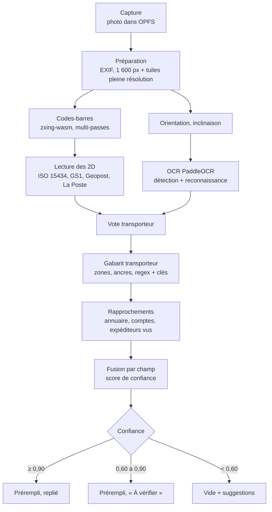
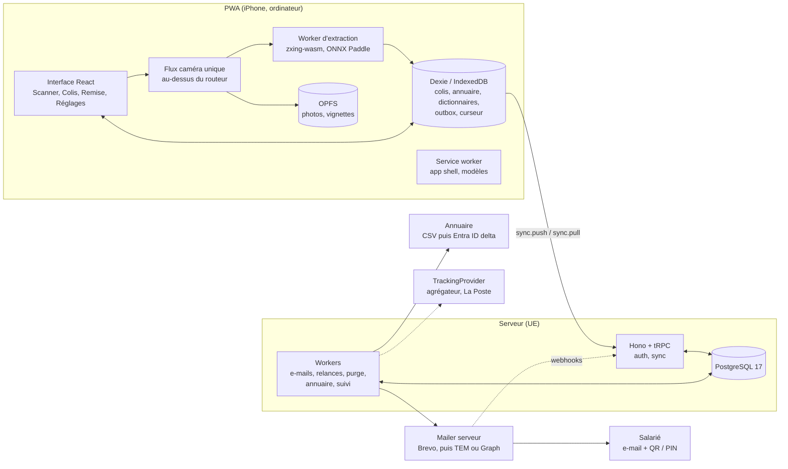
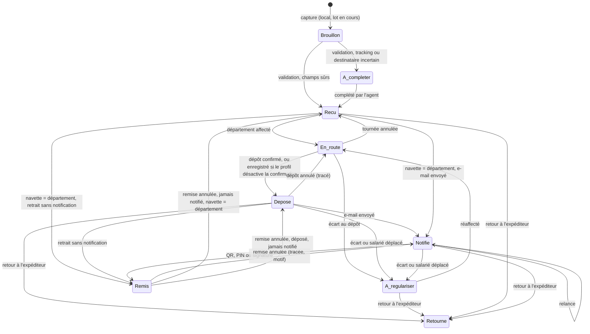

# Cahier des charges — Courrier v3

30 octobre 2026 · Révise la v2 du 21 octobre 2026 selon le modèle multi-entreprises du 29 octobre 2026

Ce document décrit Courrier, l'app de réception et de remise des colis d'une entreprise, proposée à plusieurs entreprises clientes. Il s'appuie sur le cahier des charges de la v1 et sur six rapports de recherche (`docs/research/01` à `06`). Le service courrier de Saint Laurent, pour lequel la v1 a été écrite, en est le premier client ; rien dans le produit visé ne lui est propre (ME34).

**Comment lire la v3.**

- **Ce qui est livré.** Le document décrit le produit visé. Tant que les fonctionnalités F35 à F42 du plan ne sont pas livrées, l'app fonctionne comme en v2 : un agent, un service, des e-mails envoyés depuis la messagerie du téléphone.
- **Deux séries de F.** Les exigences F01 à F63 (§3) ne sont pas les fonctionnalités F1 à F42 du plan de projet (hors dépôt). Pour éviter la collision, les exigences du modèle multi-entreprises s'appellent ME01, ME02… et le §3.7 les range par fonctionnalité du plan.
- **« L'agent ».** Partout où il reste, le mot désigne le compte qui fait le geste : la navette à la réception, le département à la remise.
- **« Le service ».** De même, il se lit « l'entreprise », sauf quand le §2.1 distingue les départements.

**Comment lire les chiffres.** Chaque chiffre porte l'étiquette de son rapport d'origine :

| Étiquette | Sens |
| --- | --- |
| **[vérifié]** | Lu dans une source officielle, ou recalculé pendant la recherche |
| **[source tierce]** | Article, comparatif ou forum, plausible mais non confirmé |
| **[estimation]** | Ordre de grandeur déduit, à mesurer sur iPhone réel |
| **[cible]** | Objectif que nous proposons, à valider avec le service, pas une mesure |

Aucune donnée nominative de l'annuaire n'apparaît dans ce document.

---

## 1. Contexte, objectifs, périmètre

### 1.1 Contexte

La v1, écrite pour un seul service courrier, est une page HTML unique (2 286 lignes, ES5) hébergée sur GitHub Pages. Elle tourne sur l'iPhone de l'agent, sans serveur, et ses données sont stockées dans `localStorage`. Elle a prouvé l'idée : photographier un bordereau, préremplir les champs, prévenir les destinataires par e-mail. Mais elle bute sur des limites de fond :

- **Lecture.** Tesseract lit mal les étiquettes en cases et le texte vertical. Les codes-barres sont rarement lus sur photo (1 sur 5 en test). L'expéditeur n'est trouvé que 2 fois sur 6. Toutes ces mesures ont été faites dans un émulateur Chrome, jamais sur iPhone.
- **Fiabilité.** Un faux tracking (`7185713569`) a été enregistré sans alerte. La cause : un repli qui accepte « n'importe quel nombre de 10 ou 12 chiffres ». À l'inverse, presque tous les champs sont affichés en orange, si bien que le signal ne veut plus rien dire.
- **Notification.** Elle passe par `mailto:` : un e-mail à la fois, envoyé depuis le compte configuré dans l'app Mail (un Gmail personnel lors des tests), sans aucune trace de l'envoi.
- **Données.** Elles vivent sur un seul téléphone, sans synchronisation ni purge. L'annuaire de 101 personnes est écrit dans le code d'un dépôt public.
- **Hors ligne.** Il est annoncé mais pas garanti : le moteur OCR et ses fichiers de langue ne sont pas mis en cache par le service worker (rapport 02, §3.3).

**Une chaîne, plusieurs entreprises.** Le produit est une chaîne navette → département → salarié, pour plusieurs entreprises clientes : la navette scanne les colis reçus et les dépose aux départements, le département confirme le nombre reçu et remet au salarié, l'admin entreprise voit l'ensemble, l'admin de l'app gère les entreprises sans voir leurs colis.

### 1.2 Objectifs mesurables

Les seuils de lecture seront recalés après le spike S3 (§10), qui mesurera le niveau de départ sur iPhone.

| # | Objectif | Indicateur | Cible | Référence v1 |
| --- | --- | --- | --- | --- |
| O1 | Aucun faux numéro de suivi enregistré en silence | Trackings faux affichés comme sûrs (confiance ≥ 0,90) sur le corpus | 0 **[cible]** | 1 cas connu (`7185713569`) |
| O2 | Tracking lu sans saisie | Part du corpus où le tracking est prérempli et juste | ≥ 95 % **[cible]** | 6/6 en émulateur, critère v1 : ≥ 9/10 |
| O3 | Bon destinataire trouvé | Destinataire juste, ou présent dans les 3 suggestions | ≥ 95 % **[cible]** | Critère v1 : ≥ 9/10 |
| O4 | L'expéditeur, point faible de la v1, progresse | Expéditeur juste ou proposé | ≥ 70 % au lancement, puis en hausse grâce à l'apprentissage **[cible]** | 2/6 |
| O5 | L'agent n'attend jamais | Délai entre une capture et la possibilité de capturer le colis suivant | ≤ 1 s **[cible]** | 5 à 25 s d'attente par photo (ordinateur) |
| O6 | Analyse rapide en arrière-plan | Temps d'extraction complète par photo sur l'iPhone du service | p50 ≤ 3 s, p95 ≤ 5 s **[cible]** (1 à 3 s **[estimation]**, rapport 04) | Non mesuré sur iPhone ; < 15 s visé |
| O7 | Notification fiable et tracée | E-mails envoyés par le serveur, avec un statut visible | 100 % des envois tracés **[cible]** | Aucune trace |
| O8 | Remise prouvée | Remises enregistrées avec une preuve (QR, PIN ou signature) | 100 % **[cible]** | « Marquer remis », sans preuve |
| O9 | Zéro perte de données | Colis perdus lors des scénarios de test (mode avion, verrouillage, app tuée, relance) | 0 **[cible]** | Non testé |
| O10 | Vraiment hors ligne | Parcours complet réception → revue → remise en mode avion, après un premier lancement | Réussi sur iPhone **[cible]** | Critère v1 ouvert |

### 1.3 Périmètre : ce qui change par rapport à la v1

| Sujet | v1 | Produit visé |
| --- | --- | --- |
| Architecture | Une page statique, aucun serveur | PWA et petit serveur (API, base de données, envoi d'e-mails), sur la même stack qu'Emis |
| Saisie | Un colis à la fois, formulaire long | **Scan en rafale** : un geste par colis, revue en fin de lot |
| Lecture | ZXing 1D et Tesseract | zxing-wasm 1D **et 2D** (PDF417, Aztec, Data Matrix, MaxiCode), clés de contrôle, OCR neuronal multi-orientation |
| Expéditeur | OCR seul | Codes 2D, puis **dictionnaire appris** n° de compte → expéditeur, puis OCR guidé, puis expéditeurs déjà vus |
| Confiance | Orange presque partout | Score par champ, trois niveaux, affiché par une icône et un libellé (pas par la couleur seule) |
| E-mail | `mailto:`, un à la fois, compte personnel | Envoi par le serveur (file d'attente, reprises, statut), adresse du service, QR et PIN de retrait |
| Remise | Bouton « Marquer comme remis » | QR ou PIN scanné, signature en secours, journal |
| Relance | Aucune | Relances automatiques, puis alerte à l'agent |
| Données | `localStorage`, un seul téléphone | Base locale (IndexedDB) synchronisée avec le serveur, photos dans OPFS restées sur l'iPhone, plusieurs appareils dont un ordinateur |
| Annuaire | Écrit dans le code public | Tenu par l'admin entreprise et par chaque département, import CSV (D15 révisée), puis synchronisation Entra ID (cible) |
| Conservation | Aucune règle | Durées réglées par entreprise (D28), purge automatique |
| Clients et rôles | Un téléphone, pas de compte | Plusieurs entreprises, quatre rôles, département à plusieurs comptes, profil de fonctionnement par entreprise (D21, D22, D30) |

**Dans le périmètre :** comptes par invitation, entreprises et départements, tournée et dépôt, profil de fonctionnement, réception en rafale, extraction du bordereau, revue de lot, journal et recherche, annuaire, notification par e-mail avec relances, remise avec preuve, synchronisation hors ligne, export CSV, import de l'historique v1, espace département et administration sur ordinateur.

**Hors périmètre :** facturation et abonnements (D29), casiers connectés, kiosque en libre-service, SMS, notifications push aux salariés, application native, gestion de plusieurs sites (le point de réception est porté par le département), suivi temps réel de tous les transporteurs en direct (seulement via un agrégateur, en option), IA de vision embarquée comme moteur principal.

---

## 2. Utilisateurs, rôles et parcours

### 2.1 Rôles

| Rôle | Ce qu'il fait | Accès |
| --- | --- | --- |
| Admin de l'app | Crée, suspend et supprime les entreprises, invite leur premier admin, suit les chiffres d'usage. Hors de toute entreprise | Ordinateur |
| Admin entreprise | Gère départements, comptes, annuaire, réglages et profil de son entreprise ; voit tous ses colis, réaffecte les colis à régulariser | Ordinateur surtout |
| Département | Entité à plusieurs comptes (D22), avec son point de réception, ses horaires et ses consignes. Confirme les dépôts, remet aux salariés, tient son annuaire. Le service courrier est un département comme un autre | Ordinateur pour le suivi, mobile pour le scan (D23) |
| Navette | Réceptionne en rafale, revoit les lots, fait sa tournée et dépose aux départements. Peut faire office de département si le profil le dit | PWA sur iPhone |
| Destinataire (salarié) | Reçoit l'e-mail avec son QR et son PIN, vient retirer son colis | Aucun accès à l'app |
| Délégué (assistant, collègue) | Retire un colis pour le compte d'un salarié (lot L3) | Aucun accès, il reçoit une copie de l'e-mail |
| DSI / DPO | Valident l'hébergement, l'envoi d'e-mails, l'annuaire, la conservation | Hors app |

**Droits par rôle** (D21 à D27, D15 révisée).

| Donnée ou action | Admin de l'app | Admin entreprise | Département | Navette |
| --- | --- | --- | --- | --- |
| Entreprises : créer, renommer, suspendre, supprimer | Oui | Non | Non | Non |
| Chiffres d'usage de la plateforme | Oui, chiffres seulement (D26) | Ceux de son entreprise (rapports) | Non | Non |
| Colis | Aucun | Tous ceux de l'entreprise | Les siens : à venir, présents, passés | Ceux de ses tournées |
| Annuaire | Aucun | Tous les départements, lecture et écriture | Le sien, lecture et écriture | Tout, en lecture |
| Comptes | Invite le premier admin d'une entreprise | Crée par invitation, rattache, suspend et révoque navettes et comptes département | Non | Non |
| Profil de fonctionnement | Le choisit à la création | Le modifie librement (D30) | Non | Non |
| Réglages de l'entreprise (D28) | Non | Oui | Lieu, horaires, consignes du département (§3.7.9) | Non |
| Dépôt | Non | Non | Confirme le nombre, déclare un écart | Dépose |
| Colis « À régulariser » (D25) | Non | Voit et réaffecte | Déclare | Voit |
| Remise au salarié | Non | Non | Oui, avec un code de son département seulement | Si elle fait office de département |

### 2.2 Parcours d'un colis

Ces parcours décrivent les gestes ; le §2.3 dit qui les enchaîne selon le rôle. Le profil de fonctionnement (§3.7.4) peut désactiver ou rendre facultative une étape.

**P0. Premier lancement (une seule fois)**
1. L'agent ouvre l'adresse dans Safari. L'app détecte qu'elle n'est pas installée et affiche « Ajouter à l'écran d'accueil », avec un mode d'emploi illustré. Sans installation, Safari peut effacer les données après 7 jours d'inactivité **[vérifié]**.
2. Une fois installée, l'agent se connecte. L'app télécharge l'annuaire et les modèles de lecture (30 à 55 Mo **[estimation]**), avec une barre de progression, de préférence en Wi-Fi.
3. L'app demande le stockage persistant (`navigator.storage.persist()`) et affiche « Prêt hors ligne ».

**P1. Réception en rafale (cœur de l'usage)**
1. Onglet **Scanner** → « Démarrer un lot ». iOS demande la caméra, potentiellement à chaque lancement **[vérifié]**, bug WebKit 215884.
2. L'agent vise une étiquette et appuie sur l'obturateur (gros bouton, zone du pouce). La vignette rejoint le bandeau du lot, avec un bip et un flash vert. Pas de vibration : elle n'existe pas sur iOS **[source tierce]**.
3. L'extraction tourne en arrière-plan pendant que l'agent enchaîne. Chaque vignette affiche son état : en cours, OK, à vérifier, échec.
4. Si le même colis est capturé deux fois, l'app affiche « Déjà dans ce lot » (ou « Déjà reçu le … » s'il est déjà en base), avec un lien vers ce colis.
5. Un toast « Colis ajouté · Annuler » reste visible 5 secondes.
6. Si l'app est fermée en cours de route, le lot est restauré au lancement suivant.

**P2. Revue de lot**
1. « Terminer le lot » ouvre la liste triée : les cas incertains d'abord, les cas sûrs repliés et cochés.
2. Pour chaque cas incertain : photo zoomable en haut, **un seul champ à vérifier à la fois**, 3 suggestions de destinataire sous forme de puces, bouton « Valider et suivant » en bas.
3. Un colis sans tracking ou sans destinataire sûr n'est jamais bloquant. On l'enregistre en **À compléter**, et il n'est pas notifié.
4. « Valider le lot » ouvre le récapitulatif : N colis enregistrés, M e-mails prêts, K à compléter.

**P3. Notification**

> **D2 révisée le 29/10/2026 :** le serveur envoie. L'état livré, un e-mail prérempli dans la messagerie du téléphone ([`docs/spikes/S5-email-messagerie.md`](spikes/S5-email-messagerie.md)), reste en repli ; rien n'en est retiré (précision du 30/10/2026).

1. Au moment choisi par le profil (au scan ou au dépôt), l'app demande un e-mail par destinataire, qui regroupe tous ses colis en attente. La demande part dans la file d'envoi, en ligne ou hors ligne.
2. Le serveur envoie par Brevo, avec des reprises en cas d'échec et depuis l'expéditeur de l'entreprise. Les webhooks remontent le statut réel : chaque colis affiche « E-mail délivré à 10:42 » ou « Échec : adresse refusée · Corriger ».
3. Si le serveur d'envoi est indisponible, l'agent peut utiliser le repli par la messagerie du téléphone.

**P4. Remise avec preuve**
1. Onglet **Remise** : l'agent scanne le QR affiché sur le téléphone du salarié, tape le PIN, ou cherche son nom.
2. L'app liste tous les colis en attente de cette personne, tous cochés. « Remettre tout » ou une sélection.
3. La preuve est le QR ou le PIN validé. Sans eux, le salarié peut signer sur l'écran, selon le profil.
4. Le colis passe à **Remis**, avec l'heure, l'agent et la méthode. Toast « Annuler ». Tout cela fonctionne hors ligne.

**P5. Relance**
1. Un colis notifié et non retiré est relancé à J+2 puis à J+5 jours ouvrés (D12, lundi à vendredi ; les jours fériés ne sont pas connus et comptent comme ouvrés), comptés à partir du dépôt. Le serveur envoie un e-mail par personne, avec le modèle de relance de l'entreprise et le même code de retrait, si le profil active les relances. Le bandeau « N personnes à relancer » et l'écran « Colis en souffrance » (« Relancer », « Relancer les N ») restent pour relancer à la main.
2. Deux jours ouvrés après la seconde relance (ou dès J+5 si les deux relances ne sont pas parties), le colis est « En souffrance » (compteur cliquable). L'agent décide : relancer encore à la main, appeler, ou retourner à l'expéditeur (L3).

**P6. Recherche**
1. Onglet **Colis** : barre de recherche instantanée, insensible aux accents, sur le tracking, le nom, le service, l'expéditeur et le transporteur, avec résultats à chaque frappe.
2. Filtres en puces : À compléter, En attente de retrait, En souffrance, Remis, Aujourd'hui.
3. Liste groupée par destinataire ou par date. La fiche colis montre la photo, tous les champs modifiables, l'historique des événements et l'état de synchronisation.

### 2.3 Parcours par rôle

**R1. Création d'une entreprise (admin de l'app)**
1. Dans le back-office, l'admin de l'app crée l'entreprise et choisit un modèle de profil : « Petit site, la navette remet », « Multi-départements » ou « Traçabilité stricte ». Il ajuste le profil paramètre par paramètre.
2. Il invite le premier admin de l'entreprise. Il suit ensuite les chiffres d'usage, et peut suspendre ou supprimer l'entreprise. Il ne voit jamais un colis ni un salarié.

**R2. Invitation (admin de l'app, admin entreprise)**
1. L'admin entreprise crée les départements, puis invite navettes et comptes département.
2. L'invité reçoit par e-mail un lien à durée limitée. Il change son mot de passe à la première connexion (D27) ; la connexion reste bloquée tant que ce n'est pas fait.

**R3. Tournée (navette)**
1. La navette réceptionne en rafale (P1) et revoit le lot (P2). Le destinataire est cherché dans tout l'annuaire ; sa suggestion ramène son département, modifiable. Un colis sans département reste « À compléter ».
2. Le colis passe « En route ». L'écran « À déposer » groupe les colis par département, avec leur nombre, hors ligne compris.

**R4. Dépôt (navette, département)**
1. Au département, la navette scanne le QR imprimé du département ou le choisit. L'app affiche le nombre de colis à déposer.
2. Le département confirme le nombre reçu, pas forcément le détail (D24). Les colis passent « Déposé » des deux côtés.
3. En cas d'écart (manquant, en trop, salarié parti), le colis passe « À régulariser », visible par la navette et l'admin entreprise, qui le réaffecte (D25). Il reste bloqué jusque-là.
4. Si le profil envoie l'e-mail au dépôt, aucun salarié n'est prévenu avant cette confirmation.

**R5. Remise au département (département)**
1. Le salarié vient au point de réception de son département. Sur mobile, le compte département scanne son QR ou tape son code, puis scanne le colis si le profil le demande (P4).
2. Le code n'est valable qu'au département du colis. Le colis passe « Remis », avec un journal de remise, hors ligne compris.
3. Sur ordinateur, le département suit ses colis à venir, présents et passés, avec une recherche.

**R6. Vue d'ensemble (admin entreprise)**
1. Le tableau de bord donne, par département, les colis en route, en attente de retrait, en souffrance et à régulariser, avec un accès direct à ces derniers.
2. Les rapports par département s'exportent. Un changement de profil s'applique à tous les colis tout de suite ; l'écran annonce les colis touchés avant d'enregistrer (D31).

---

## 3. Exigences fonctionnelles

Origine : **Nouveau** = absent de la v1 ; **Repris** = repris tel quel ; **Amélioré** = idée v1 refaite (référence v1 entre parenthèses).
Priorité MoSCoW : M = Must, S = Should, C = Could, W = Won't (hors périmètre).
Lots : voir §10. Le MVP correspond aux lots L0 à L2.

### 3.1 Installation, capture et lots

| ID | Exigence | Origine | Prio | Lot |
| --- | --- | --- | --- | --- |
| F01 | Installation guidée sur l'écran d'accueil ; aucune saisie hors ligne tant que l'app n'est pas installée | Nouveau | M | L0 |
| F02 | Mode rafale : caméra ouverte pendant tout le lot, un appui = un colis, aucune confirmation par colis | Nouveau (remplace F01/F09 v1) | M | L1 |
| F03 | Repli photo native (`<input capture>`) et import multiple depuis la photothèque | Amélioré (F01, F02) | M | L1 |
| F04 | Saisie manuelle du tracking ; transporteur déduit du format **et** de la clé de contrôle | Amélioré (F10) | M | L1 |
| F05 | Guidage de prise de vue : cadre, alerte de flou, alerte de reflet | Nouveau | S | L1 |
| F06 | Capture automatique quand l'image est nette et qu'un code-barres est déjà lu dans le flux vidéo | Nouveau | C | L3 |
| F07 | Lampe torche si l'appareil la propose (déconseillée sur les étiquettes plastifiées, à cause des reflets) | Repris | S | L1 |
| F08 | Bandeau du lot : vignettes avec état (icône + texte), compteur, toast « Annuler » de 5 s | Nouveau | M | L1 |
| F09 | Lot restauré après fermeture ou plantage de l'app | Nouveau | M | L1 |
| F10 | Doublons : tracking normalisé (casse, espaces, tirets), alerte non bloquante, lien vers le colis existant | Amélioré (F13) | M | L1 |
| F11 | Action « Même destinataire que le précédent » (plusieurs colis pour une même personne) | Amélioré (conservation du destinataire v1) | S | L1 |
| F12 | Retour de scan visuel et sonore (bip et flash), réglable ; vibration seulement là où elle existe (Android, ordinateur) | Amélioré (vibration v1, inopérante sur iOS) | M | L1 |

### 3.2 Extraction du bordereau (détails au §4)

| ID | Exigence | Origine | Prio | Lot |
| --- | --- | --- | --- | --- |
| F13 | Lecture de tous les codes-barres de la photo (1D, PDF417, Aztec, Data Matrix, QR, MaxiCode quand il est net) dans un Web Worker | Amélioré (ZXing 1D v1) | M | L1 |
| F14 | Lecture du contenu structuré des codes 2D : ISO 15434 (UPS, FedEx, DPD), GS1, Data Matrix La Poste | Nouveau | M | L1 |
| F15 | Détecteur MaxiCode maison (repérage, redressement, décodage) | Nouveau | S | L3 |
| F16 | Validation du tracking par transporteur (format et clé) ; jamais de repli « nombre quelconque » | Amélioré (règles v1) | M | L1 |
| F17 | OCR neuronal multi-orientation sur le téléphone (famille PaddleOCR), Tesseract v7 en plan B | Nouveau (remplace Tesseract 5) | M | L1 |
| F18 | Destinataire : codes 2D, puis OCR guidé, puis rapprochement flou avec l'annuaire, 3 suggestions | Amélioré (F11, F12) | M | L1 |
| F19 | Expéditeur : codes 2D, dictionnaire n° de compte → expéditeur, OCR guidé, expéditeurs déjà vus | Amélioré | M | L1 |
| F20 | Colis n/N, poids, niveau de service, référence expéditeur | Amélioré (nombre de colis v1) | S | L1 |
| F21 | Score de confiance par champ, trois niveaux d'affichage | Amélioré (F05) | M | L1 |
| F22 | Diagnostic « Voir ce qui a été lu » : codes décodés, texte OCR, source et score de chaque champ, durées | Repris (F08) | M | L1 |
| F23 | Apprentissage : chaque correction de l'agent alimente le dictionnaire des expéditeurs, les contacts hors annuaire et les comptes ; partagé entre appareils | Nouveau | M | L1 |
| F24 | Renfort cloud optionnel sur les champs faibles (recadrage seulement, région UE) | Nouveau | C | L4 |

### 3.3 Revue, journal, statuts

| ID | Exigence | Origine | Prio | Lot |
| --- | --- | --- | --- | --- |
| F25 | Revue de lot triée par confiance, un champ incertain à la fois, validation groupée des cas sûrs | Nouveau | M | L1 |
| F26 | Statut « À compléter » : enregistré sans notification quand le tracking ou le destinataire ne sont pas sûrs | Nouveau | M | L1 |
| F27 | Destinataire hors annuaire mémorisé comme contact local (nom, e-mail facultatif), proposé ensuite | Amélioré (F12) | M | L1 |
| F28 | Journal : recherche instantanée sans accents, filtres en puces, groupement par destinataire ou par date, liste virtualisée | Amélioré (F14) | M | L1 |
| F29 | Fiche colis : tous les champs modifiables, photo zoomable, historique des événements, état de synchronisation | Amélioré (F16) | M | L1 |
| F30 | Statuts explicites et réversibles (voir §8.3) ; suppression du statut mort « En attente » de la v1 | Amélioré (F15) | M | L1 |
| F31 | Actions groupées : sélection, renotifier, marquer remis | Repris | S | L2 |
| F32 | Compteurs cliquables (À compléter, À retirer, À relancer, En souffrance) en tête de l'onglet Colis | Amélioré (Accueil v1) | S | L2 |

### 3.4 Notification et relance

| ID | Exigence | Origine | Prio | Lot |
| --- | --- | --- | --- | --- |
| F33 | Envoi par le serveur via une file d'attente (outbox), avec reprises et statut réel (D2 révisée, Brevo au MVP) ; messagerie du téléphone en repli, avec son suivi déclaratif | Nouveau (remplace l'envoi manuel) | M | L2 |
| F34 | Un e-mail par destinataire, regroupant ses colis ; « par service » devient un résumé optionnel | Amélioré (F17) | M | L2 |
| F35 | E-mail en HTML et en texte, accents corrects ; lieu, horaires et consignes du département ; code de retrait écrit en clair et QR de retrait en image | Amélioré | M | L2 |
| F36 | Repli par la messagerie du téléphone (`mailto:`, Outlook, Gmail, « copier le texte », partage du QR) si l'envoi serveur est indisponible ; livré, gardé tel quel (D2 révisée) | Repris | S | L2 |
| F37 | Relances automatiques à J+2 et J+5 jours ouvrés après le dépôt, envoyées par le serveur si le profil les active (modèle « Relance », même code de retrait) ; relance à la main possible ; puis alerte « En souffrance » | Nouveau | S | L2 |
| F38 | Copie à un délégué ou à des collègues, par e-mail | Amélioré (F18) | C | L3 |
| F39 | Envoi à heures fixes (créneaux) plutôt qu'immédiat | Nouveau | C | L3 |

### 3.5 Remise

| ID | Exigence | Origine | Prio | Lot |
| --- | --- | --- | --- | --- |
| F40 | Onglet Remise : scan du QR, saisie du PIN, ou recherche par nom → colis en attente → « Remettre tout » | Nouveau | M | L2 |
| F41 | Vérification hors ligne du QR et du PIN (empreintes synchronisées à l'avance) | Nouveau | M | L2 |
| F42 | Signature tactile et photo de remise facultatives, en secours (D6), ou obligatoires si le profil le dit (D30) ; gardées sur l'iPhone (D8) | Nouveau | S | L2 |
| F43 | Journal de remise : qui, quand, quel agent, quelle méthode | Nouveau | M | L2 |
| F44 | Annulation d'une remise par erreur (avec trace) | Nouveau | S | L2 |

### 3.6 Données, synchronisation, administration

| ID | Exigence | Origine | Prio | Lot |
| --- | --- | --- | --- | --- |
| F45 | Hors ligne complet après le premier lancement : app, modèles, annuaire, journal | Amélioré (F21, garanti cette fois) | M | L0-L1 |
| F46 | Synchronisation entre appareils (iPhone et ordinateur) | Nouveau (hors périmètre v1) | M | L0-L1 |
| F47 | Pastille d'état de synchronisation, « N en attente », alerte au-delà de 24 h, export de secours en JSON | Nouveau | M | L1 |
| F48 | Mise à jour de l'app non bloquante (bandeau, jamais en plein lot) et « Forcer la mise à jour » | Nouveau | M | L0 |
| F49 | Comptes et connexion ; les quatre rôles sont au §3.7.2 | Nouveau | M | L0 |
| F50 | Import de l'annuaire en CSV par l'admin entreprise, hors du code, dédoublonné par e-mail | Repris (F22, jamais fait en v1) | M | L1 |
| F51 | Export CSV lisible dans Excel (`;`, BOM, cellules neutralisées contre les formules) | Repris (F20) | M | L1 |
| F52 | Import de l'historique v1 (format CSV v1), avec revalidation des trackings par les clés de contrôle | Nouveau | M | L1 |
| F53 | Purge automatique selon les durées de conservation | Nouveau (point ouvert v1) | M | L2 |
| F54 | Emplacement de stockage du colis (étagère, casier) | Nouveau | S | L3 |
| F55 | Étiquette interne imprimable (nom, service, emplacement, code-barres) | Nouveau | C | L3 |
| F56 | Lettres recommandées : type dédié, n° d'AR, signature facultative (D6) | Nouveau | S | L3 |
| F57 | Vues ordinateur : tableau des colis, revue, annuaire, rapports (délai de retrait, volumes par transporteur et par jour) ; en L2 pour le département et l'admin entreprise (§3.7.7, §3.7.8) | Nouveau | S | L2 |
| F58 | Synchronisation de l'annuaire depuis Entra ID (Graph delta), par entreprise qui le demande, CSV conservé en secours | Nouveau | S | L4 |
| F59 | Envoi depuis la boîte partagée de l'entreprise via Microsoft Graph, pour celle qui le demande | Nouveau | S | L4 |
| F60 | Connexion des comptes via Entra ID, par entreprise qui le demande | Nouveau | S | L4 |
| F61 | Suivi transporteur via un agrégateur (statut ; expéditeur seulement s'il est fourni) | Nouveau | C | L4 |
| F62 | Résumé quotidien dans un canal Teams (webhook Workflows) | Nouveau | C | L4 |
| F63 | Mode sombre suivant le système, avec bascule manuelle | Nouveau | S | L1 |
| W1 | Casiers, kiosque, SMS, push aux salariés, gestion de plusieurs sites, app native, facturation (D29) | — | W | — |

### 3.7 Modèle multi-entreprises

Ces exigences sont toutes de lot L2 et priorité M, sauf mention contraire. Chaque fonctionnalité du plan a sa section.

| Fonctionnalité du plan | Section | Tickets |
| --- | --- | --- |
| F35 Envoi des e-mails par le serveur | §3.7.1 | YSL-112 à YSL-115 |
| F36 Départements et rôles | §3.7.2 | YSL-116 à YSL-119, YSL-83 |
| F37 Plateforme et entreprises | §3.7.3 | YSL-120 à YSL-123 |
| F38 Profil de fonctionnement et réglages | §3.7.4 | YSL-124 à YSL-127 |
| F39 Annuaire partagé | §3.7.5 | YSL-128 à YSL-130 |
| F40 Tournée et dépôt | §3.7.6 | YSL-131 à YSL-135 |
| F41 Espace département | §3.7.7 | YSL-136, YSL-82 |
| F42 Vue d'ensemble de l'admin entreprise | §3.7.8 | YSL-137, YSL-88 |

#### 3.7.1 Envoi des e-mails par le serveur (F35, D2 révisée, D28)

| ID | Exigence |
| --- | --- |
| ME01 | Adaptateur Brevo derrière l'interface `Mailer`, remplaçable par Scaleway TEM ou Graph sans toucher aux appelants ; file d'envoi avec reprises espacées et idempotence par message |
| ME02 | Webhook authentifié par jeton (Brevo ne signe pas ses événements) : délivré, rebond, plainte, désinscription. Statut réel sur la fiche colis et dans le suivi ; un rebond propose de corriger l'adresse |
| ME03 | Nom et adresse d'expédition par entreprise ; enregistrements SPF et DKIM affichés pour la DSI du client, vérification par Brevo ; repli sur le domaine de la plateforme tant que le domaine n'est pas vérifié |
| ME04 | Un e-mail par destinataire avec QR et code de retrait, modèles par entreprise, relances envoyées par le serveur, messagerie du téléphone gardée en repli |

#### 3.7.2 Départements et rôles (F36, D7 révisée, D21 à D23)

| ID | Exigence |
| --- | --- |
| ME05 | Département : nom, point de réception, lieu, horaires, consignes ; plusieurs comptes par département ; le service courrier est un département comme un autre |
| ME06 | Quatre rôles (§2.1) contrôlés côté serveur |
| ME07 | Synchronisation et API filtrées selon le tableau du §2.1 : aucune fuite entre départements ni entre entreprises |
| ME08 | Le serveur garde les colis pour que le département et l'admin entreprise les voient ; les photos d'étiquettes n'en font pas partie (D8) |
| ME09 | Conversion de la prod : organisation → entreprise, département par défaut « Service courrier », texte `department` → départements, admin → admin entreprise, agent → navette ; répétée sur une copie, avec un plan de retour arrière |
| ME10 | Navigation et accueil par rôle, sur mobile et sur ordinateur ; un rôle n'atteint aucune route d'un autre |
| ME11 | L'admin entreprise crée, rattache à un département, suspend et révoque les comptes navette et département |

#### 3.7.3 Plateforme et entreprises (F37, D26, D27, D29)

| ID | Exigence |
| --- | --- |
| ME12 | Compte de plateforme sans entreprise, procédures séparées ; il ne lit aucune donnée nominative d'une entreprise |
| ME13 | Back-office : liste, création avec un modèle de profil, renommage, suspension (plus de connexion ni de synchronisation), suppression avec purge des données |
| ME14 | Invitation par e-mail à durée limitée, mot de passe à changer à la première connexion ; lien expiré ou réutilisé refusé. `auth:create-user` ne sert plus qu'au premier admin de l'app |
| ME15 | Chiffres par entreprise (comptes, départements, colis du mois, dernière activité) et journal des actions de l'admin de l'app |

#### 3.7.4 Profil de fonctionnement et réglages (F38, D28, D30, D31)

Une étape du profil est **désactivée, facultative ou obligatoire**. Le modèle est choisi par l'admin de l'app à la création ; l'admin entreprise modifie ensuite librement, sans verrou. Sans profil enregistré, une entreprise garde le comportement d'avant le profil ; le profil est lu à chaque usage, rien ne le recopie sur un colis.

| Paramètre | Valeurs |
| --- | --- |
| Navette = département | Oui ou non : la navette remet elle-même |
| Revue du lot | Trois états |
| Confirmation du dépôt | Désactivée, au nombre, colis par colis |
| Preuve de remise | QR ou code, trois états |
| Scan du colis à la remise, signature, photo | Trois états chacun |
| Moment de l'e-mail | Au scan ou au dépôt |
| Relances | Trois états |

| ID | Exigence |
| --- | --- |
| ME16 | Règle du profil partagée entre l'iPhone et le serveur (`@repo/contract`) |
| ME17 | Un changement s'applique à tous les colis, tout de suite ; l'écran annonce avant d'enregistrer les colis touchés (« 12 colis prêts devront être signés ») |
| ME18 | Trois modèles à la création : « Petit site, la navette remet », « Multi-départements », « Traçabilité stricte » |
| ME19 | Réglages : nom et logo dans l'app et les e-mails, interface neutre sinon (D14) ; expéditeur ; durées de conservation propres à l'entreprise |
| ME20 | Les étapes livrées suivent le profil : revue du lot, preuve, signature et photo, destinataire sans e-mail, retrait par un collègue, réserves |
| ME34 | Nom et adresse de réception réglés par entreprise, qui remplacent les ancres d'extraction et le code postal aujourd'hui écrits en dur pour le premier client (`packages/contract/src/extract/recipient.ts`, `packages/contract/src/recipient/words.ts`) et le libellé « Adressé hors de 75007 » (`packages/shared/src/i18n/locales/fr.ts`) ; le préfixe technique `YSL:RETRAIT:` des QR reste, il n'est pas affiché et les codes émis doivent rester lisibles ; sans ces réglages, le colis d'une autre entreprise prend un malus et le drapeau « réexpédition ? » |

#### 3.7.5 Annuaire partagé (F39, D15 révisée)

| ID | Exigence |
| --- | --- |
| ME21 | L'admin entreprise tient tous les départements : ajout, modification, déplacement d'un salarié, import CSV. Salarié déplacé : ses colis à venir suivent, ses colis déposés passent « À régulariser » |
| ME22 | Chaque département tient le sien ; il ne voit ni ne modifie les salariés d'un autre. L'adresse e-mail est unique par département : une adresse présente ailleurs n'est ni refusée ni signalée, et l'admin entreprise voit les fiches à même adresse. Le département demande le déplacement d'un salarié depuis sa fiche ; seul l'admin déplace |
| ME23 | La navette lit tout l'annuaire ; la suggestion de destinataire ramène le département ; destinataire inconnu : « À compléter » |

#### 3.7.6 Tournée et dépôt (F40, D24, D25)

| ID | Exigence |
| --- | --- |
| ME24 | Statuts En route, Déposé et À régulariser (§8.3), réversibles comme les autres, règle partagée entre l'iPhone et le serveur |
| ME25 | Département pris du destinataire à la revue du lot, modifiable ; colis sans département bloqué à « À compléter » |
| ME26 | Écran « À déposer » groupé par département, hors ligne compris |
| ME27 | QR imprimable de chaque département ; la navette le scanne ou choisit le département, l'app affiche le nombre ; le département confirme le nombre reçu |
| ME28 | Écart au dépôt : colis « À régulariser », visible par la navette et l'admin entreprise, qui réaffecte |
| ME29 | E-mail au scan ou au dépôt selon le profil, avec les lieu, horaires et consignes du département ; relances comptées à partir du dépôt, ou de la réception si la navette fait office de département |

#### 3.7.7 Espace département (F41, D23)

| ID | Exigence |
| --- | --- |
| ME30 | Sur ordinateur et sur mobile : colis à venir, présents, historique, recherche ; confirmation du dépôt et déclaration d'écart |
| ME31 | Remise sur mobile : QR ou code du salarié, puis scan du colis selon le profil ; code d'un autre département refusé ; hors ligne compris |

#### 3.7.8 Vue d'ensemble de l'admin entreprise (F42)

| ID | Exigence |
| --- | --- |
| ME32 | Tableau de bord par département : en route, en attente de retrait, en souffrance, à régulariser, avec accès direct aux colis à régulariser |
| ME33 | Rapports par département et export ; l'admin de l'app n'en voit que les chiffres agrégés |

#### 3.7.9 Points ouverts du modèle

Le modèle du 29/10/2026 ne les tranche pas. Le choix provisoire vaut jusqu'au ticket indiqué, qui le confirme ou le corrige.

| Point | Choix provisoire | Ticket |
| --- | --- | --- |
| Confirmation au nombre (D24) : quels colis passent « À régulariser » quand le nombre ne correspond pas ? | Celui qui déclare l'écart désigne les colis concernés | YSL-134 |
| Profil « e-mail au scan » : quel statut avant le dépôt ? | Le colis reste « En route », avec son e-mail tracé ; il passe « Notifié » à la confirmation du dépôt, sans nouvel e-mail, et ne se remet qu'à partir de là | YSL-131, YSL-135 |
| L'iPhone tire aujourd'hui le QR et le code, le serveur n'en a que les empreintes : comment le serveur met-il le QR dans l'e-mail ? | Le serveur tire le code à l'envoi et les empreintes redescendent par la synchronisation ; le repli par la messagerie garde le tirage sur l'iPhone | YSL-115 |
| Photos d'étiquettes sur l'iPhone de la navette seulement (D8) : que voit le département sur la fiche ? | Les champs lus, sans photo ; un doute sur l'étiquette repasse par la navette | YSL-82 |
| Qui règle le lieu, les horaires et les consignes d'un département ? | Le département, et l'admin entreprise (confirmé) | YSL-116 |
| Durées de conservation d'une entreprise neuve (D28) | Celles du §9.2 par défaut | YSL-126 |
| Navette faisant office de département : point de départ des relances | La réception | YSL-135 |
| Colis réaffectés (D25) : qui réaffecte ? Le texte « la navette et l'admin entreprise, qui réaffecte » se lit de deux façons | L'admin entreprise seul | YSL-134 |
| Relance par le serveur « avec le même code », alors qu'il n'en garde que les empreintes | Le serveur tire un nouveau code à chaque relance et retire l'ancien : le §8.7 dit déjà « remplacé » ; « même code » ne vaut que pour le repli par la messagerie | YSL-115 |
| Conversion de la prod : profil de l'entreprise convertie et colis en cours | Profil qui reproduit l'agent unique (la navette remet, « Petit site ») ; les colis gardent leur statut | YSL-118 |
| Cycle de vie d'une tournée : ouverture, clôture, colis « À compléter » | Un colis entre dans la tournée de la navette qui l'a validé ; la tournée se clôt quand tous sont déposés ; un colis « À compléter » reste visible de cette navette | YSL-133 |
| Un même code de retrait couvre des colis de deux départements, ou un contact hors annuaire | Un code par personne et par département ; un contact prend le département du colis | YSL-117, YSL-136 |
| Second admin d'une entreprise, ou remplacement du seul | L'admin entreprise invite un autre admin ; s'il n'y en a plus, l'admin de l'app réinvite, sans voir de donnée nominative | YSL-122 |
| Trois états sur une étape sans geste humain ou sans objet | Relances : désactivées, à la main (facultatives), automatiques (obligatoires). Preuve désactivée : remise par le nom, tracée `manuel` | YSL-124, YSL-127 |
| La clause de revoyure PowerSync (§7.2) vise plusieurs sites et de nombreux agents sur les mêmes colis | Confirmé par YSL-117 : la synchronisation filtrée par rôle reste sur Dexie, le filtre et les relectures étant côté serveur (`docs/synchronisation.md`) ; à revoir si les volumes le demandent | YSL-117 |

---

## 4. Chaîne d'extraction du bordereau (fonction phare)

### 4.1 Principes

1. **Le code d'abord, l'OCR ensuite, l'humain en dernier.** Les codes-barres contiennent le tracking sans erreur possible de lecture. Les codes 2D contiennent souvent aussi le destinataire, le n/N et le poids.
2. **Jamais de numéro inventé.** Un tracking doit passer le format **et** la clé de son transporteur, ou à défaut le format plus un contexte (logo, mot-clé). Sinon, le champ reste vide et une suggestion est proposée.
3. **Chaque valeur connaît sa source et sa confiance.** C'est ce qui permet de n'alerter l'agent qu'à bon escient et d'expliquer chaque décision dans le diagnostic.
4. **L'extraction ne bloque jamais l'agent.** Elle tourne dans un Worker pendant qu'il capture le colis suivant.

### 4.2 Étapes

Budgets de temps : estimations du rapport 04 pour un iPhone 15 ou 16, à mesurer au spike S3.

| # | Étape | Outil | Budget **[estimation]** |
| --- | --- | --- | --- |
| 0 | Capture : image la plus nette du flux vidéo (`ImageCapture.grabFrame` sur Safari 26), ou photo native en repli. Écriture immédiate dans OPFS, seule une vignette de 200 px max reste en mémoire | getUserMedia / `<input capture>` | avant le chrono |
| 1 | Préparation : orientation EXIF, version de travail à ~1 600 px pour l'OCR ; les codes-barres sont lus sur l'image pleine résolution découpée en tuiles (chaque canvas reste sous la limite iOS de 16,7 Mpx **[source tierce]**) | `createImageBitmap`, OffscreenCanvas | ~50 ms |
| 2 | Codes-barres : passe 1 sur l'image entière ; passe 2 sur des tuiles de 50 % qui se chevauchent de 25 % ; passe 3 ciblée (agrandissement, autre binariseur) là où un code est attendu. On s'arrête dès que tous les codes attendus pour ce transporteur sont lus | zxing-wasm (Worker) | 100 à 300 ms |
| 3 | Lecture des contenus : ISO 15434, GS1 (AI), Data Matrix La Poste, 1D Geopost `%…` (DPD, Colissimo), reconstruction du 1Z UPS depuis le MaxiCode | TypeScript maison | < 10 ms |
| 4 | Orientation globale 0/90/180/270 en une seule inférence (remplace les 3 passes de rotation de la v1) | PP-LCNet doc_ori | 30 à 80 ms |
| 5 | Inclinaison : angle médian des boîtes de texte ; redressement de perspective seulement si l'angle est fort (OpenCV chargé à la demande) | maison / jscanify | 0 à 400 ms |
| 6 | Détection du texte (quadrilatères quelconques, y compris vertical) | PP-OCRv5 mobile det (ou v6 tiny/small selon le banc d'essai) | 200 à 600 ms |
| 7 | Reconnaissance ligne par ligne, lignes verticales tournées avant lecture | PP-OCRv5 mobile rec (ou v6) | 400 à 1 500 ms |
| 8 | Reconstitution des blocs, gabarit du transporteur (zones attendues placées grâce à la position des codes lus), ancres (`SHIP TO`, `FROM`, `EXPÉDITEUR`…), règles de format | TypeScript maison | 20 à 50 ms |
| 9 | Rapprochements : destinataire ↔ annuaire, expéditeur ↔ dictionnaire et historique | TypeScript maison | 10 à 30 ms |
| 10 | Fusion par champ, score de confiance, résultat transmis à la revue | TypeScript maison | < 10 ms |
| | **Total sur le téléphone** | | **≈ 1 à 3 s [estimation]**, cible p95 ≤ 5 s |

Règles d'exécution :

- Tout tourne dans un Web Worker et une seule photo est traitée à la fois.
- Les sessions ONNX sont préchauffées au démarrage. WebGPU est utilisé s'il est disponible, WASM sinon.
- Pic mémoire visé : moins de 250 Mo **[estimation]**. Au-delà, Safari tue l'onglet au lieu de refuser l'allocation **[vérifié]**, bugs WebKit.

### 4.3 Sources par ordre de priorité

Les confiances de base viennent du rapport 03, §4.2. Elles seront recalibrées sur le corpus.

| Rang | Source | Confiance de base |
| --- | --- | --- |
| 1 | Champ d'un code 2D structuré décodé et cohérent avec la structure attendue | 0,97 |
| 2 | Tracking d'un code 1D dont le format est reconnu **et** la clé du transporteur valide | 0,95 |
| 3 | Valeur déduite d'un code : pays (ISO numérique), transporteur (code SCAC ou préfixe), 1Z UPS reconstruit puis validé | 0,93 |
| 4 | Code 1D au format reconnu, sans clé connue (Mondial Relay, Amazon, GLS) | 0,85 |
| 5 | OCR dans la zone attendue + format + clé valide | 0,85 |
| 6 | OCR dans la zone attendue + format valide, sans clé disponible | 0,65 |
| 7 | OCR hors zone, ou sans validation de format | 0,40 |
| 8 | Dictionnaire appris ou historique | 0,30 à 0,90 selon le cas (§4.8) |
| 9 | Saisie ou correction de l'agent | 1,00 (et réinjectée dans l'apprentissage) |

**Ajustements :**
- **Deux sources indépendantes concordent** (tracking 2D = tracking 1D ; code postal du 2D = code postal lu par OCR ; n/N du 2D = « 1 OF 3 » lu par OCR) : confiance = 1 − (1 − c1)(1 − c2), plafonnée à 0,99.
- **Deux sources se contredisent :** on garde la source la mieux classée, avec un malus de 0,15 et la mention « À vérifier ».
- **Cohérence métier :**
  - le destinataire doit être à l'adresse de réception de l'entreprise (code postal et pays, ME34). Sinon, malus et drapeau « réexpédition ? » ;
  - un nom présent dans l'annuaire avec une similarité Jaro-Winkler ≥ 0,92 donne un bonus de 0,10 ;
  - le poids doit être plausible (0,01 à 70 kg ; conversion depuis les livres pour les étiquettes d'origine US) ;
  - n ≤ N.

### 4.4 Seuils d'affichage

| Confiance | Affichage | Comportement |
| --- | --- | --- |
| ≥ 0,90 | Prérempli, carte repliée, coche « Lu » | Validé avec le lot sans action |
| 0,60 à 0,90 | Prérempli, icône d'attention + libellé « À vérifier » (jamais la couleur seule) | Proposé un par un dans la revue |
| < 0,60 | Champ vide, meilleures suggestions en puces | L'agent choisit ou saisit |

Le **tracking** et le **destinataire** sont obligatoires pour notifier : ils doivent atteindre 0,90 ou être confirmés par l'agent. Sinon, le colis est enregistré en **À compléter**, sans notification, et l'agent n'est pas bloqué. Le type « Sans suivi » (coursier, pli remis en main propre) se choisit explicitement : l'app génère alors un identifiant interne.

Les seuils sont des points de départ. Ils seront recalés sur le corpus pour que le taux de faux « sûrs » (≥ 0,90) soit nul sur le tracking (O1).

### 4.5 Règles par champ

| Champ | Source n° 1 | Repli | Contrôle |
| --- | --- | --- | --- |
| Tracking | 1D validé par clé, ou 2D | OCR + format + clé | Égalité 1D/2D ; unicité en base |
| Transporteur | Vote pondéré : SCAC du 2D (1,0), format + clé du tracking (0,9), logo ou mot-clé OCR (0,6), mise en page (0,4) | Question posée si égalité | Cohérence avec le format du tracking |
| Destinataire (personne) | 2D : FedEx `G61`, DPD `RecContact` / `PERSNAME`, GS1 4300-4301 | OCR du bloc `SHIP TO` / `À` / `DESTINATAIRE` / `CONTACT`, autour des ancres de l'entreprise, son nom et son adresse (ME34) | Annuaire, puis contacts hors annuaire |
| Service / étage | 2D DPD `RecCompName2`, `PERSDEPARTMENT`, `PERSFLOOR` | OCR (« Attn », « c/o », « Service ») | Liste des services de l'annuaire |
| Expéditeur | 2D DPD `S01` / `NotifSender*`, GS1 4310+ | Dictionnaire n° de compte → expéditeur, puis OCR du bloc `FROM` / `SHIPPER` / `EXPÉDITEUR`, puis expéditeurs déjà vus | Correspondance approximative avec les expéditeurs connus |
| Colis n/N | 2D (UPS, FedEx, DPD) | OCR « 1 OF 3 », « 1/3 », « Colis 1 sur 3 », en ignorant les dates (règles v1) | n ≤ N ; regroupement par n° d'expédition |
| Poids | 2D | OCR « KG » / « LBS » | Plage plausible |
| Service transporteur | 2D (code) + table de libellés | OCR (« EXPRESS SAVER »…) | — |
| Référence | 2D (DPD `ConsCustRef1`, UPS ID d'expédition, FedEx `L11`) | OCR « REF » | — |
| Date de réception | Horodatage de la capture | — | — |

### 4.6 Règles par transporteur

Formats et clés : rapport 03. Étiquettes de fiabilité : OFF = officiel ; SEC = source secondaire ; VÉR = algorithme testé ; DÉD = déduit.

| Transporteur | Format du tracking | Clé de contrôle | Codes présents sur l'étiquette | Fiabilité | Règle de décision |
| --- | --- | --- | --- | --- | --- |
| UPS | `1Z` + 6 (compte expéditeur) + 2 (service) + 7 + 1 | mod 10, poids 1/2 | Code 128 (1Z), MaxiCode | Format SEC, clé VÉR | Accepté si la clé est valide. Les 6 caractères du compte alimentent le dictionnaire des expéditeurs. Si le MaxiCode est lu : 1Z reconstruit, gardé seulement si la clé est valide |
| FedEx Express | 12 chiffres | mod 11 puis mod 10, poids 3-1-7 | Code 34 chiffres (les 12 derniers = tracking), PDF417 (contenu non publié) | SEC + VÉR ; 34 chiffres OFF | Extraire les 12 derniers chiffres du code 34 ; clé obligatoire. **Supprimer** la règle v1 `8701\d{8}` |
| FedEx Ground | 15 affichés ; code « 96 » de 22 chiffres | mod 10, poids 3-1 | Code « 96 », PDF417 (enveloppes 01 et 03 : destinataire complet) | OFF + VÉR | Clé obligatoire ; SCAC `RPSB` / `RPSC` |
| DHL Express | 10 chiffres (WAYBILL) ; pièce `JJD…` | mod 7 | 1D WAYBILL, 1D JJD, routage `2L` (code postal, pays) | Format OFF, clé SEC + VÉR | La clé laisse passer environ 1 suite aléatoire sur 7 : il faut **aussi** un contexte (logo DHL, mot « WAYBILL » ou code JJD), sinon confiance plafonnée à « À vérifier » |
| Colissimo (domestique) | 2 caractères produit + 10 chiffres + clé (13) | mod 10, poids 3-1, sur les 10 chiffres | 1D Geopost `%` + code postal + `11` + ID, Aztec (structure probablement Geopost, DÉD) | OFF + VÉR | Lire l'ID dans le 1D, recalculer la clé. Le format ressemble à celui des lettres suivies La Poste : on départage avec la clé et le contexte |
| La Poste (lettre suivie, recommandé) | `\d[A-Z]\d{11}` ou 14 chiffres | non trouvée | Data Matrix (tracking aux caractères 9 à 22) | OFF pour le format | Data Matrix d'abord ; sans clé, OCR plafonné à « À vérifier » |
| UPU S10 (international, EMS, recommandés étrangers) | 2 lettres + 8 chiffres + clé + 2 lettres pays | mod 11, poids 8-6-4-2-3-5-9-7 | 1D | OFF + VÉR | Clé obligatoire |
| Chronopost | 2 lettres + 9 chiffres + 2 lettres (13) ; 15 depuis l'étranger | **Inconnue** (voir l'encadré) | 1D, Aztec probable | SEC | Format + contexte « Chronopost » ; la clé S10 **n'est pas** un critère de rejet |
| DPD | 14 caractères + 1 caractère de clé (imprimé en clair seulement) | ISO 7064 MOD 37,36 | 1D Geopost `%` + code postal + tracking + service + pays ; **Aztec le plus riche** (destinataire, n/N, poids, compte, parfois expéditeur) | OFF + VÉR | Tracking lu dans le 1D ; clé vérifiée sur le texte en clair quand il est lu. Supprimer le filtre v1 « hors 0075 » au profit de la lecture structurée |
| TNT | 9 chiffres (8 + clé) ; parfois `GE` + 9 + `WW` | mod 11, poids S10 | 1D | Format OFF, clé SEC | Clé utilisée comme bonus ; format défini enfin, faute d'exemple en v1 |
| GLS | 11 + 1 chiffres | non trouvée | 2 Data Matrix (le second contient l'adresse du destinataire) | SEC | Ne jamais rejeter sur la clé ; contenu des 2D à cartographier sur étiquettes réelles |
| Amazon, Mondial Relay, Colis Privé, coursiers | variable | aucune | variable | SEC ou non trouvé | Confiance plafonnée ; contexte OCR obligatoire |
| GS1 (SSCC, AI) | `00` + 18 | mod 10 GS1 | GS1-128, GS1 Data Matrix, GS1 QR | OFF + VÉR | Identifiant de colis et adresses (4300+, 4310+) lus directement |

**À abandonner, venant de la v1 :**
- le repli « premier nombre de 10 ou 12 chiffres » ;
- la règle `8701\d{8}` ;
- `\d{13}` → Colissimo ;
- toute déduction du transporteur par la seule longueur ;
- l'acceptation d'un code-barres comme « fiable » dès qu'il a une forme de tracking (`looksLikeTracking`).

> **Contradiction relevée et tranchée.** Le rapport 03 suppose que Chronopost utilise la clé S10 (« probable », déduit). Or l'exemple Chronopost testé en v1, `HA915306631JB`, **échoue** à la clé S10 (calcul refait pour ce document : clé attendue 5, chiffre lu 1). **Décision :** pas de rejet sur la clé pour Chronopost tant que le corpus n'a pas tranché.

**Cas de non-régression vérifiés** (calculs refaits pour ce document avec les algorithmes du rapport 03) :

| Exemple v1 | Résultat attendu | Contrôle |
| --- | --- | --- |
| `1ZE6344W0499230622` (UPS) | Accepté | Clé UPS valide |
| `877974873338` (FedEx) | Accepté | Clé FedEx 12 valide |
| `5413337112` (DHL) | Accepté **avec contexte** | Clé mod 7 valide |
| `8J02299079750` (Colissimo) | Accepté | Clé mod 10 (3-1) valide |
| `HA915306631JB` (Chronopost) | Accepté sur format + contexte, sans clé | Clé S10 invalide (voir plus haut) |
| `10464000209404` (DPD) | Accepté via le 1D ou le contexte | Clé imprimée seulement en clair, non disponible ici |
| `7185713569` (faux FedEx de la v1) | **Rejeté** : champ vide ou « À vérifier », jamais « sûr » | Clé DHL mod 7 invalide, pas au format FedEx |

### 4.7 Ce que les codes 2D apportent (synthèse du rapport 03)

- **Sans OCR :** tracking, transporteur, code postal et pays du destinataire, service ; selon le transporteur, aussi le nom ou la société du destinataire, le n/N et le poids.
- **L'expéditeur n'y figure presque jamais**, sauf dans le bloc DPD hors UE et dans GS1 4310+. En revanche, UPS, FedEx Ground et DPD y mettent un **n° de compte expéditeur stable** : c'est la clé de l'apprentissage (§4.8).
- **MaxiCode (UPS) :** les bibliothèques gratuites ne le lisent que sur une image parfaitement droite et nette **[vérifié]**. Un MaxiCode non lu ne coûte pas le tracking, car le 1Z est aussi imprimé en Code 128. Le détecteur maison (F15) est donc un « Should ». L'achat de Dynamsoft (~1 371 $/an pour 10 000 scans **[source tierce]**, prix revendeur) n'est à envisager que si le corpus montre un vrai manque (décision D11).

### 4.8 Apprentissage local

Toutes ces tables sont synchronisées : ce qu'un agent apprend profite aux autres appareils.

| Table | Clé | Alimentée par | Effet |
| --- | --- | --- | --- |
| `sender_account` | (transporteur, n° de compte) | Chaque expéditeur validé par l'agent sur un colis qui porte un n° de compte (caractères 3 à 8 du 1Z UPS, ID FedEx Ground, `CustAccNumber` DPD, préfixe GS1) | Expéditeur prérempli à 0,90, puis 0,95 après 3 confirmations, sans OCR |
| `sender` | Nom normalisé | Expéditeurs validés | Correspondance approximative avec le texte OCR du bloc expéditeur ; suggestions en puces |
| `contact` (hors annuaire) | Nom normalisé + e-mail | Destinataires saisis hors annuaire | Suggestions, rapprochement OCR |
| `directory_person` | E-mail | Import CSV, puis Entra ID | Rapprochement flou du destinataire |
| Corrections | Colis | Différence entre la valeur proposée et la valeur validée | Statistiques de qualité par champ et par transporteur, enrichissement du corpus |

Heuristiques v1 reprises comme tests :
- corrections OCR (chiffre lu à la place d'une lettre, mot coupé, `|` lu pour `I`, particules) ;
- pondération nom/prénom et tolérance Levenshtein 1 au-delà de 5 lettres ;
- exclusion des débris du nom de la société.

La liste figée des 55 prénoms en « I » de la v1 est remplacée par les prénoms de l'annuaire.

### 4.9 Corpus de test et métriques

**Corpus :**
- 100 photos réelles au minimum avant les spikes, à porter à 200 ensuite. Le rapport 03 recommande 100 à 200, le rapport 04 50 à 100 ; nous retenons le haut de la fourchette commune.
- Au moins 6 transporteurs et 10 étiquettes par transporteur (critère v1).
- Avec des cas difficiles : reflets, inclinaison, texte vertical, étiquettes froissées, MaxiCode.
- Prises sur l'iPhone du service, avec l'accord de l'entreprise (décision D4).
- Annotation manuelle : tracking, transporteur, destinataire, expéditeur, n/N, poids.
- Version floutée pour le dépôt de code ; originaux conservés hors dépôt, dans un espace validé par le DPO.

**Trois niveaux de tests :**
1. **Tests unitaires en CI (Vitest)** :
   - clés de contrôle, sur les exemples des sources et les cas du §4.6 ;
   - parseurs 2D, sur les chaînes publiées (exemple MaxiCode, spécification DPD) ;
   - règles d'extraction, sur des fixtures texte (texte OCR brut et codes décodés, exportés depuis le diagnostic F22).
2. **Banc d'essai sur iPhone**, à chaque changement de modèle ou de règles : le corpus complet passe dans l'app en mode diagnostic, et un rapport est généré.
3. **Suivi en production** : taux de correction par champ, calculé à partir de la table des corrections.

| Métrique (par champ et par transporteur) | Définition | Cible |
| --- | --- | --- |
| Exactitude | Valeur finale proposée = annotation | Tracking ≥ 95 %, destinataire ≥ 95 % (top 3), expéditeur ≥ 70 % au lancement **[cible]** |
| Faux sûrs | Valeur ≥ 0,90 mais fausse | 0 sur le tracking, ≤ 2 % sur les autres champs **[cible]** |
| Taux de préremplissage | Champ ≥ 0,60 | Mesuré, pour suivre l'évolution |
| Lecture des codes | Codes lus / codes présents, par format (1D, PDF417, Aztec, Data Matrix, MaxiCode) | Mesuré au spike S2 ; v1 : 1 sur 5 en 1D sur photo |
| Temps | p50 et p95 par photo, de la capture au résultat | p50 ≤ 3 s, p95 ≤ 5 s **[cible]** |
| Mémoire | Pic pendant une rafale de 50 photos | < 250 Mo, aucun plantage **[cible]** |

---

## 5. Exigences non fonctionnelles

### 5.1 Performance et fluidité

| Domaine | Exigence | Valeur |
| --- | --- | --- |
| Capture | Délai entre deux captures | ≤ 1 s **[cible]** |
| Extraction | Par photo, en arrière-plan | p50 ≤ 3 s, p95 ≤ 5 s **[cible]** ; 1 à 3 s **[estimation]** |
| Rafale | 50 colis d'affilée sans plantage ni ralentissement | Exigé **[cible]**, testé au spike S1 |
| Mémoire | Pic | < 250 Mo **[estimation]** ; photos traitées une par une ; vignettes ≤ 200 px ; `ImageBitmap.close()` et `revokeObjectURL` systématiques |
| Listes et recherche | Lecture locale | Affichage < 100 ms (rapport 06) ; liste virtualisée ; résultats à chaque frappe |
| Transitions | Durée | 150 à 250 ms, `ease-out`, désactivées si `prefers-reduced-motion` |
| Interface | Aucune tâche lourde sur le fil principal | Codes-barres, OCR et redimensionnement dans des Workers (la v1 figeait l'écran) |
| Démarrage | Ouverture hors ligne | App shell en précache ; modèles préchauffés après le premier affichage, sans le retarder |

### 5.2 Chargement : quand skeleton, quand rien, quand affichage immédiat

Règle générale, tirée des recommandations NN/g citées par le rapport 06 **[source tierce]** :
- moins d'1 s : on n'affiche rien ;
- jusqu'à environ 10 s : skeleton pour une page ou une liste, ou indicateur pour une action ;
- au-delà de 10 s, ou pour un téléchargement : barre de progression.

Comme les données sont locales, la plupart des écrans s'affichent en moins de 100 ms : **les skeletons sont l'exception**.

| Situation | Traitement | Pourquoi |
| --- | --- | --- |
| Liste ou fiche lue dans la base locale | **Rien** : affichage direct. Skeleton seulement si rien n'est arrivé au bout de 300 ms (réglage proposé, pour éviter un clignotement) | Données locales, < 100 ms |
| Toute écriture (enregistrer, valider, remettre, corriger) | **Affichage immédiat (UI optimiste)** : visible tout de suite, petite icône « en attente de synchronisation » sur l'élément ; en cas de rejet du serveur, l'élément passe en erreur avec « Corriger » | La file locale garantit l'écriture |
| Premier lancement, première synchronisation, annuaire initial | **Skeleton** reprenant la géométrie exacte des cartes | Chargement réseau, sous 10 s |
| Vignettes et photos (fiche, revue) | **Skeleton** à la taille de l'image, fondu à l'arrivée | Évite les décalages de mise en page |
| Extraction en cours (vignette du lot, carte de revue) | **Vignette avec indicateur « Lecture… »** ; dans la revue, champs en skeleton tant que le résultat manque | Tâche de fond, quelques secondes |
| Données qui n'existent que sur le serveur (statut transporteur, rapports sur ordinateur) | **Skeleton**, puis message si l'appareil est hors ligne | Dépend du réseau |
| Téléchargement des modèles (30 à 55 Mo **[estimation]**), envoi des photos | **Barre de progression** avec taille et pourcentage | Long, mesurable |
| Action bloquante rare (forcer la mise à jour, import CSV) | **Indicateur dans le bouton**, puis résultat | 2 à 10 s |

### 5.3 Hors ligne

- Fonctionne sans réseau : capture, extraction, revue, journal, recherche, remise (QR, PIN, signature), annuaire, file d'e-mails.
- **Pas de Background Sync sur iOS** **[source tierce]**. La synchronisation est donc déclenchée par l'app au premier plan : à l'ouverture, à l'événement `online`, au retour au premier plan (`visibilitychange`), à la fin d'un lot, par un minuteur tant que l'app est visible, et par un bouton « Synchroniser ».
- `navigator.onLine` peut être vrai sur un Wi-Fi captif. La connectivité réelle est donc testée par `HEAD /health`.
- Hors ligne est un **état normal**, signalé par une pastille, jamais par une erreur.

### 5.4 Stockage sur l'appareil et taille du cache

| Élément | Taille | Statut |
| --- | --- | --- |
| Modèles PaddleOCR v5 mobile (détection + reconnaissance) | ~12 Mo (v6 small : ~30 Mo) | **[vérifié]** (rapport 04) |
| Classifieurs d'orientation | ~7 Mo (+ 1 à 6,5 Mo) | **[vérifié]**, chiffres variables selon les sources |
| onnxruntime-web | 10 à 25 Mo | **[estimation]** |
| zxing-wasm (lecteur) | ~1 Mo | **[vérifié]** (rapports 03 et 04 ; le rapport 06 indique ~2 Mo, sans doute la version complète) |
| OpenCV.js (chargé à la demande) | 8 à 10 Mo | **[estimation]** |
| Annuaire, journal, dictionnaires | < 1 Mo à quelques Mo | **[estimation]** |
| **Code + modèles** | **≈ 30 à 55 Mo** | **[estimation]**, largement sous les quotas de Safari 17+ (jusqu'à 60 % du disque par origine **[vérifié]**) |
| Photos locales | Gardées jusqu'à l'envoi confirmé, puis purgées après 7 jours (proposition) ; vignettes conservées | **[cible]** |

Les erreurs `QuotaExceededError` sont gérées. L'écran Réglages > Diagnostic affiche `persisted()` et `estimate()`. Les modèles sont versionnés par URL (avec une empreinte) et téléchargés au premier lancement.

### 5.5 Compatibilité

| Plateforme | Niveau |
| --- | --- |
| iPhone, Safari iOS 26, installé sur l'écran d'accueil | **Cible principale** (WebGPU actif par défaut, `ImageCapture.grabFrame`) |
| iOS 18.4 à 25 | Support dégradé à confirmer au spike : WASM sans WebGPU (Wake Lock corrigé depuis 18.4) |
| Onglet Safari non installé | Lecture seule et invitation à installer ; aucune saisie hors ligne |
| Ordinateur : Chrome, Edge, Safari récents | Supporté (vues dédiées en L2) |
| Paysage | Acceptable : le blocage en portrait n'est pas fiable sur iOS |
| Navigation privée | Message clair : OPFS n'y est pas disponible |

L'iPhone du service (modèle, version d'iOS) reste à identifier (décision D5). Le rapport 04 propose l'iPhone 12 comme plus ancien modèle testé.

### 5.6 Accessibilité (WCAG 2.2 AA)

- **Zoom autorisé** : pas de `user-scalable=no` (défaut v1). Police ≥ 16 px dans les champs, pour éviter le zoom automatique.
- **Cibles tactiles** de 44 × 44 px minimum, 56 px pour les actions principales. Le minimum légal est 24 px (SC 2.5.8 **[vérifié]**) ; 44 px est notre règle.
- **Contrastes** de 4,5:1 pour le texte et 3:1 pour les composants, vérifiés en mode clair et en mode sombre.
- **Jamais d'information par la couleur seule** : toujours une icône et un texte.
- Vrais `<label>`, focus visible, feuilles du bas en `role="dialog"` avec gestion du focus, `aria-live="polite"` pour les scans, la synchronisation et les toasts.
- Pas de geste sans alternative : un balayage a toujours un bouton équivalent.
- Unités `rem` (texte dynamique), respect de `prefers-reduced-motion`.
- Tests VoiceOver sur le compteur de lot, les vignettes et la remise.

### 5.7 Mises à jour

- Service worker en `registerType: 'prompt'` : jamais de mise à jour imposée pendant un lot. La mise à jour automatique (`autoUpdate`) peut faire perdre un formulaire en cours **[vérifié]**.
- `registration.update()` au démarrage, au retour au premier plan et toutes les 30 à 60 minutes.
- `sw.js` et `index.html` servis en `no-cache`.
- `/version.json` comparé à la version locale.
- « Forcer la mise à jour » ne touche jamais aux données non synchronisées.

---

## 6. UX et design

### 6.1 Architecture d'information

Navigation par 4 onglets en bas. L'app s'ouvre sur **Scanner**, à l'état « prêt » : la caméra ne démarre qu'au geste de l'agent.

| Onglet | Écrans | Contenu |
| --- | --- | --- |
| **Scanner** | Prêt → Lot en cours → Revue du lot → Récapitulatif | Viseur plein écran, obturateur, lampe, import photothèque, saisie manuelle, bandeau du lot ; revue triée par confiance ; récapitulatif avec les e-mails prêts |
| **Colis** | Liste → Fiche colis | Compteurs cliquables (À compléter, À retirer, En souffrance, Aujourd'hui), recherche, puces de filtre, groupement par destinataire ou par date, sélection multiple ; fiche avec photo, champs, historique, synchronisation, actions |
| **Remise** | Identifier → Panier de remise → Preuve → Confirmation | Scanner le QR, pavé PIN, recherche par nom ; colis en attente de la personne ; signature et photo facultatives (D6) |
| **Réglages** | Sections | Synchronisation et file d'attente, diagnostic du stockage, version et « Forcer la mise à jour », sons, thème, aide à l'installation, annuaire et lieu et horaires de retrait (selon le rôle, §2.1), compte |

Éléments communs à tous les écrans :
- pastille d'état (hors ligne, synchronisation, N en attente) dans l'en-tête ;
- bandeau de mise à jour non bloquant ;
- toasts « Annuler » ;
- parcours d'accueil au premier lancement : installation, compte, téléchargement des modèles.

Sur ordinateur : même app en mise en page large, avec tableau des colis, revue, annuaire, exports et rapports (L2 pour le département et les admins).

**Selon le rôle (§3.7.2).** Les onglets ci-dessus sont ceux de la navette et de l'agent d'aujourd'hui. La navigation et l'accueil changent selon le compte : navette (Scan, tournée), département (à venir, présents), admins (tableau de bord). Le mobile sert au scan, l'ordinateur au suivi et à l'administration.

**Ce que deviennent les onglets de la v1 :**

| Onglet v1 | Produit visé |
| --- | --- |
| Accueil | Compteurs en tête de l'onglet Colis (cliquables, contrairement à la v1) |
| Nouveau | Scanner |
| Historique | Colis |
| Employés | Réglages > Annuaire (selon le rôle), plus la recherche de destinataires partout |

### 6.2 Principes

1. **Le geste d'abord, la machine ensuite.** Un colis = un geste. On capture tout de suite, on analyse en arrière-plan, et on ne demande à l'agent que ce qui est incertain, à la fin du lot.
2. **Un seul chemin évident par écran, dans la zone du pouce.** Une action principale en bas, 4 onglets, pas de menu caché, rien d'important en haut à gauche.
3. **L'état est toujours visible, jamais anxiogène.** On voit d'un coup d'œil ce qui est sur l'iPhone, ce qui est synchronisé et ce qui attend une vérification. Les erreurs disent ce qui est sauvé et quoi faire. Tout est annulable.
4. **On montre une proposition, pas un fait.** Les valeurs lues sont présentées comme des suggestions, avec leur niveau de confiance, et le diagnostic est toujours à portée.

### 6.3 Direction visuelle

Sobriété éditoriale : le luxe par la retenue, la typographie et l'espace.

- **Marque.** Interface neutre, sans marque par défaut (D14) ; le nom et le logo d'une entreprise sont un réglage (D28).
- **Couleurs.**
  - Base : noir `#0A0A0A` et blanc cassé `#FAFAF8`.
  - Gris : `#6B6B6B` pour le texte secondaire, `#E7E7E4` pour les filets (`#262626` en mode sombre).
  - Trois couleurs d'état seulement, toujours accompagnées d'un pictogramme : ambre (à vérifier), vert profond (OK), rouge brique (erreur).
  - Pas de dégradé, pas d'ombre marquée ; séparation par des filets de 1 px.
- **Typographie.**
  - Inter pour le texte, Inter Tight pour les titres en capitales avec interlettrage. Ce sont déjà les polices d'Emis.
  - Corps ≥ 16 px.
  - Polices auto-hébergées et en précache : pas de Google Fonts, pour le hors ligne et pour ne pas transmettre d'adresse IP à un tiers.
- **Formes.** Rayons de 0 à 4 px, bordures de 1 px, boutons principaux noirs pleins (inversés en mode sombre), icônes au trait fin (Lucide).
- **Imagerie.** Les photos de colis sont le seul visuel : vignettes carrées, coins vifs. Pas d'illustration ludique.
- **Mode sombre.** Natif et de même qualité que le mode clair. La vue caméra est toujours sombre.

### 6.4 Composants clés

| Composant | Rôle | Points d'attention |
| --- | --- | --- |
| Viseur + obturateur | Capture en rafale | Un seul flux caméra, placé **au-dessus du routeur** et jamais recréé ; vue masquée (et non démontée) quand on change d'onglet ; reprise au retour au premier plan |
| Bandeau du lot | File des captures | Vignettes avec état (icône + texte), compteur annoncé par `aria-live` |
| Champ à confiance | Afficher une valeur lue | Trois états (§4.4), lien « D'où vient cette valeur ? » vers le diagnostic |
| Choix du destinataire | Choisir la personne | 3 puces de suggestions, recherche floue, « Nouveau contact » |
| Carte colis | Liste | Destinataire, transporteur, heure, badge de statut, icône de synchronisation, en 2 lignes |
| Badge de statut | Statut | Icône + libellé, jamais la couleur seule |
| Pastille de synchronisation | État global | « Hors ligne · 12 en attente », touchable vers Réglages > Synchronisation |
| Feuille du bas | Formulaires, revue | Gestion du focus, `role="dialog"`, ne démonte pas la vidéo |
| Toast avec Annuler | Retour d'action | 5 s, `aria-live`, remplace les `confirm()` de la v1 |
| Pavé PIN, lecteur QR, zone de signature | Remise | Utilisables hors ligne, à une main |
| Skeleton | Chargement | Géométrie exacte du contenu, utilisé seulement dans les cas du §5.2 |
| État vide | Écran sans données | Une phrase + une action |
| Bandeau de mise à jour | Nouvelle version | Non bloquant, masqué pendant un lot |

### 6.5 États vides, erreurs, chargement

| Écran | Vide | Erreur | Chargement |
| --- | --- | --- | --- |
| Scanner (prêt) | « Prêt à réceptionner. Démarrer un lot » | Caméra refusée : « iOS a bloqué la caméra. Réessayer, ou Prendre une photo » (repli `<input capture>`) | Démarrage de la caméra : fond noir + « Activation… » |
| Bandeau du lot | « Visez une étiquette, puis appuyez » | Lecture échouée : vignette « Échec · Reprendre ou Saisir » | Vignette « Lecture… » |
| Revue | « Tout est sûr. Valider 12 colis » | Aucune | Champs en skeleton pour les extractions non terminées |
| Colis | « Aucun colis en attente. Démarrer un lot » ; recherche vide : « Aucun résultat pour “…”. Effacer » | Rejet du serveur : élément marqué « Corriger » | Rien (local) ; skeleton seulement à la première synchronisation |
| Remise | « Scannez le QR du salarié ou tapez son PIN » | « Code inconnu ou déjà utilisé. Chercher par nom » | Rien |
| Synchronisation | « Tout est synchronisé » | « Pas de réseau. 12 colis sont enregistrés sur cet iPhone et partiront dès le retour de la connexion » ; alerte au-delà de 24 h avec « Exporter une sauvegarde » | Progression de l'envoi des photos |
| E-mail | — | « Échec d'envoi à … : adresse refusée. Corriger » | « En file » |

### 6.6 Contradictions entre rapports (UX) et arbitrages

| Sujet | Positions | Arbitrage |
| --- | --- | --- |
| Mode de capture | 03 : photo native pleine résolution (meilleure pour PDF417 et MaxiCode) · 04 et 06 : viseur en direct, rafale, capture automatique | **Viseur en direct par défaut** (rafale, un geste par colis), image extraite par `grabFrame` à la plus haute résolution du flux. **Photo native toujours disponible** (bouton « Photo HD »), utilisée automatiquement en repli si la caméra est refusée. Le spike S2 compare les taux de lecture 2D des deux modes ; si la photo native gagne nettement sur les 2D, elle devient le mode par défaut pour les transporteurs concernés |
| Résolution de traitement | 03 : codes sur la pleine résolution · 04 et 06 : ~1 600 px | Les deux : **codes-barres sur des tuiles pleine résolution** (chaque canvas sous 16,7 Mpx), **OCR sur ~1 600 px** ; photo stockée en JPEG ~1 600 px, qualité 0,8 |
| OCR ou code-barres : lequel est le plus utile ? | 06 : « l'OCR est probablement plus utile » · 03 et 04 : code d'abord | **Code d'abord** pour le tracking, le transporteur et les données structurées ; **OCR** pour le nom du destinataire et l'expéditeur. Les deux sont nécessaires |
| BarcodeDetector natif | 06 : sources contradictoires · 03 et 04 : absent sur iOS (bug WebKit 281848 **[vérifié]**) | Considéré **absent** ; zxing-wasm partout |
| Onglets | v1 : Accueil, Nouveau, Historique, Employés · 06 : Scanner, Colis, Remise, Réglages | Les 4 onglets du rapport 06 ; l'Accueil devient les compteurs de l'onglet Colis |
| Identité | v1 : noir et or, Bebas Neue · Emis : rouge, angles droits · 06 : noir et blanc cassé, sans accent décoratif | Direction du rapport 06 ; l'or est abandonné, car la couleur est réservée aux états |
| Regroupement des e-mails | v1 : par service ou par personne, CC · 05 : QR/PIN propre à chaque personne | **Par personne par défaut.** Le regroupement par service servait à limiter le nombre d'e-mails à envoyer à la main, ce qui ne se pose plus avec l'envoi serveur ; et un e-mail de service exposerait les codes de retrait des collègues |
| Retour haptique | v1 : vibration 80 ms · 06 : pas de vibration sur iOS | Bip et flash ; vibration seulement là où elle existe |
| Skeletons | Demande utilisateur : skeletons · 06 : peu utiles, les données étant locales | Règle du §5.2 : skeletons pour le réseau, le premier chargement et les images ; rien pour le local ; affichage immédiat (UI optimiste) pour les écritures |

---

## 7. Stack technique

### 7.1 Tableau

Versions : celles d'Emis relevées dans le rapport 01 (version déclarée / version résolue). « À figer » signifie que la version n'a pas été relevée dans les recherches et sera fixée au démarrage dans le `catalog:` de pnpm.

| Couche | Techno | Version | Justification |
| --- | --- | --- | --- |
| Gestionnaire, monorepo | pnpm + Turborepo | `pnpm@11.20.0`, turbo `^2.10.9` | Identique à Emis (`catalog:`) |
| Runtime | Node | ≥ 22.12, Node 24 en CI et Docker | Identique |
| Langage | TypeScript | `6.0.3` | Identique (limité à 6.x à cause de typescript-eslint) |
| UI | React, React DOM | `^19.2.0` / 19.2.8 | Identique |
| Bundler | Vite + `@vitejs/plugin-react` | `^8.0.0` / 8.2.1 ; `^6.0.1` | Identique ; `build.target: 'esnext'`, Workers en `format: 'es'` |
| Routage | TanStack Router | `^1.170.23` | Identique ; utilise l'History API (pas de hash), ce qui évite le bug caméra iOS lié au hash |
| Formulaires | TanStack Form + zod | `^1.24.1` ; zod `4.4.3` | Identique ; schémas partagés via `@repo/contract` |
| Données serveur en ligne | TanStack Query | `^5.101.4` | Identique ; limité aux appels réservés au mode en ligne (rapports, prévisualisations, statut transporteur) |
| **Base locale hors ligne** | **Dexie (IndexedDB) + `useLiveQuery`** | à figer | **Remplace PowerSync et TanStack DB** (voir §7.2) |
| Photos locales | OPFS | API navigateur | Les blobs IndexedDB ont un historique de bugs sur iOS (non vérifié), d'où le choix d'OPFS ; disponible depuis iOS 15.2 |
| PWA | vite-plugin-pwa (Workbox), `registerType: 'prompt'` | à figer | Absent d'Emis, c'est la solution que suggère le README d'Emis |
| Codes-barres | zxing-wasm | 3.1.6 (19/10/2026) | 1D et 2D, multi-codes, hors ligne, gratuit ; licence permissive (Apache-2.0 selon le rapport 03, MIT selon le 04 : à vérifier dans le paquet, sans incidence) |
| OCR | onnxruntime-web + ppu-paddle-ocr, modèles PP-OCRv5 mobile (ou v6 tiny/small) et PP-LCNet | à figer après le spike S3 | Multi-orientation, ~12 à 30 Mo, MIT et Apache-2.0 |
| OCR (plan B) | Tesseract.js v7 | à figer | Si Paddle ne tient pas sur iPhone ; Scribe.js écarté (licence AGPL-3.0) |
| Redressement (à la demande) | jscanify / OpenCV.js | à figer | Seulement pour les prises très en biais |
| Styles | Tailwind CSS 4 + tailwind-variants + tailwind-merge | `^4.3.3` ; `^3.3.1` ; `^3.6.0` | Identique ; nouveaux jetons de design pour Courrier |
| Composants | Composants maison (comme Emis), plus des primitives Radix **à la carte** (Dialog) et vaul (feuilles du bas) | à figer | Voir l'arbitrage du §7.4 |
| Icônes | Lucide | à figer | Trait fin |
| API | Hono + tRPC 11 | `^4.13.1` ; `11.18.0` | Identique ; routes Hono hors tRPC pour l'envoi des photos et les webhooks |
| Auth | Better Auth (email + mot de passe) ; Microsoft Entra en cible | `^1.6.26` | Identique ; plugin `jwt()` inutile sans PowerSync |
| Base de données | PostgreSQL + drizzle-orm / drizzle-kit + `pg` | 17 (image épinglée) ; `^0.45.2` ; `^0.31.10` ; `^8.22.0` | Identique ; `wal_level=logical` n'est plus nécessaire |
| File de tâches | Table Postgres + `SELECT … FOR UPDATE SKIP LOCKED`, worker dans le process serveur | — | Volume faible (20 à 100 colis par jour **[estimation]**) : pas de Redis ni de BullMQ |
| E-mail | Interface `Mailer` : Brevo (MVP, D2 révisée), Scaleway TEM ou Microsoft Graph `sendMail` ensuite ; messagerie du téléphone en repli | — | Rapport 05 et spike S5 ; changer de voie ne demande pas de réécriture |
| Suivi transporteur | Interface `TrackingProvider` : agrégateur (Ship24 ou 17TRACK) + API La Poste Okapi | — | Optionnel (L4) |
| Env, logs, i18n | `@t3-oss/env-core`, pino, i18n maison | `^0.13.1` ; `^10.3.1` | Identique ; fusionnés dans `@repo/shared` |
| Tests | Vitest, Playwright | `^4.1.10` ; `^1.57.0` | Identique ; 2 ou 3 tests e2e de base + banc d'essai d'extraction |
| Qualité | ESLint 9 + typescript-eslint, Prettier | `^9.39.1`, `^8.66.0` ; `^3.7.4` | Identique (`--max-warnings 0`) |
| CI | GitHub Actions (3 jobs parallèles) | `checkout@v5`, `pnpm/action-setup@v6`, `setup-node@v6` | Identique |
| Hébergement | Conteneurs Docker du serveur et de l'app + Postgres, sur Coolify, **en UE** (Hetzner) | — | Décision D1. Pas de stockage objet : le serveur garde les comptes, les annuaires et les colis (D7 révisée), les photos restent sur l'iPhone (D8). En-têtes COOP/COEP sur toute l'app pour le WASM multithread |

### 7.2 Choix du hors ligne : PowerSync ou alternative légère

**Décision : une alternative légère (Dexie + outbox maison + synchronisation par curseur), et non PowerSync.**

| Critère | PowerSync (Emis) | Dexie + outbox + curseur |
| --- | --- | --- |
| Infrastructure | 3 conteneurs (service PowerSync, Postgres de stockage, API), `wal_level=logical`, publication à réconcilier, JWKS, redémarrage à chaque changement de règle, image `latest` non épinglée (rapport 01) | Aucune en plus : 2 procédures tRPC (`sync.pull`, `sync.push`) |
| Déclaration d'une table | 3 déclarations non vérifiées entre elles | 1 schéma zod partagé |
| Moteur sur iOS | SQLite WASM dans OPFS : JSPI absent, `readwrite-unsafe` absent ; fermeture des accès OPFS en arrière-plan observée sur Capacitor, non vérifiée en PWA (rapport 06) | IndexedDB, mature sur Safari ; volume faible |
| Maturité | TanStack DB en 0.1.x et 0.2.x, API instable | Dexie mûr ; `useLiveQuery` réactif |
| Besoin réel | 1 à quelques agents, quelques milliers de colis, peu d'écritures concurrentes sur un même colis | Couvert |
| Ce qu'on perd | Résolution de conflits et réplication partielle fournies | À écrire : environ 2 procédures et une règle de conflit simple (§8.4) |

**L'argument décisif :** le volume et la concurrence sont faibles. Le seul vrai risque est de perdre une saisie faite hors ligne, et une outbox idempotente le couvre. PowerSync ajoute une infrastructure et un moteur WASM dont le comportement en arrière-plan sur iOS n'est pas vérifié, pour un bénéfice (synchronisation fine, multi-onglets) dont ce projet n'a pas besoin.

**Ce qu'on garde d'Emis :**
- identifiants générés par le client ;
- horodatage d'écriture côté client ;
- procédures idempotentes ;
- classement des erreurs opération par opération (400, 403, 404, 409 abandonnés et signalés ; 401 et erreurs réseau retentées) ;
- version du schéma local ;
- vidage sécurisé de la file avant déconnexion.

**Clause de revoyure :** si le multi-sites ou de nombreux agents qui modifient les mêmes colis deviennent un besoin, on repasse sur PowerSync, limité aux 2 ou 3 tables utiles.

### 7.3 Ce qu'on allège par rapport à Emis

| Emis | Courrier |
| --- | --- |
| 12 packages | 6 : `apps/web`, `apps/server`, `packages/api`, `packages/db`, `packages/contract`, `packages/shared` (env + logger + i18n) ; le module d'extraction est isolé dans `packages/extraction` (pur TypeScript, testable sous Node) |
| PowerSync + TanStack DB + wa-sqlite + `vite-plugin-wasm` pour SQLite | Dexie ; le WASM ne sert qu'à zxing et onnxruntime |
| Règles d'import strictes multiples | Les deux essentielles : `import type` seulement depuis `@repo/api`, pas d'import entre features |
| 3 générateurs `turbo gen` | Seulement `translation-key` |
| Storybook 10 | Reporté ; une page de démo des composants dans l'app au début |
| e2e avec stack PowerSync jetable | 2 ou 3 tests e2e de base + banc d'essai d'extraction |
| Transcrypt + 3 profils chiffrés | Gestionnaire de secrets de l'hébergeur |
| Multi-environnements, worktrees à ports décalés | dev + prod au démarrage |
| Limitation de débit par IP, `TRUSTED_PROXY_HOPS` | Conservés (l'app est exposée sur Internet), réglage simple |

### 7.4 Contradictions entre rapports (technique) et arbitrages

| Sujet | Positions | Arbitrage |
| --- | --- | --- |
| Base hors ligne | 01 : PowerSync surdimensionné · 06 : PowerSync + OPFSCoopSyncVFS pressenti | Dexie + outbox (§7.2) |
| Composants | 01 : Emis sans bibliothèque headless, tailwind-variants maison · 06 : shadcn/ui en base | Approche Emis, avec des primitives Radix et vaul **seulement** pour les feuilles et les dialogues (focus, accessibilité), conformément au README d'Emis (« ajouter une lib headless le jour où un composant complexe l'exige ») ; pas de shadcn complet. Tailles relevées à 44 px |
| Lecture des QR de remise | 05 : jsQR ou zxing-wasm | zxing-wasm seul (déjà embarqué) |
| Taille de zxing-wasm | 03 et 04 : ~1,04 Mio · 06 : ~2 Mo | ~1 Mo pour le lecteur seul ; à mesurer dans le build |
| OCR dans le cloud | v1 : « la photo n'est jamais envoyée » (mais `worker.js` envoyait vers l'API d'Anthropic) · 04 : renfort cloud hybride | Désactivé par défaut. Activable seulement après avis du DPO, en envoyant **uniquement le recadrage** de l'étiquette (sans EXIF), vers une région UE (Mistral, Vertex UE, Azure France), via un proxy serveur. Le tracking ne vient **jamais** d'un LLM |
| Envoi des e-mails | v1 : jamais d'envoi sans action de l'agent · 05 : envoi serveur automatique | **D2 révisée le 29/10/2026** : envoi serveur automatique par Brevo, la messagerie de l'iPhone reste en repli |

---

## 8. Architecture, données, synchronisation, API

### 8.1 Vue d'ensemble

### 8.2 Modèle de données

Les noms des tables et des champs ajoutés par le modèle multi-entreprises sont indicatifs : les tickets de F36 à F40 les fixent. Clés primaires : UUID v7 générés par le client. Chaque table synchronisée porte `created_at`, `updated_at`, `deleted_at` (suppression logique) et `server_seq`, un compteur serveur monotone qui sert de curseur de synchronisation.

| Table | Champs principaux | Notes |
| --- | --- | --- |
| `user` (Better Auth) | id, email, nom, rôle (admin de l'app, admin entreprise, département, navette), actif, mot de passe à changer | Un compte est rattaché à une entreprise, sauf l'admin de l'app, et à un département pour le rôle département |
| `organization` | id, nom, logo, profil de fonctionnement, durées de conservation, statut | L'entreprise. Toutes les autres tables y sont rattachées |
| `mail_sender` | entreprise, nom et adresse d'expédition, domaine, statut, enregistrements DNS | L'expéditeur de l'entreprise (YSL-114), non synchronisé. Un domaine n'appartient qu'à une entreprise |
| `department` | id, organization_id, nom, point de réception, lieu, horaires, consignes, QR de dépôt | Le service courrier est un département comme un autre |
| `directory_person` | id, nom, prénom, email, department_id, site, source (`manuel`, `csv`, `entra`), actif | Minimisation : pas de téléphone ni de manager |
| `contact` | id, nom, email?, créé par, nb_utilisations | Destinataires hors annuaire |
| `batch` | id, agent_id, started_at, ended_at, nb_colis | Lot de réception |
| `parcel` | id, batch_id, type (`colis`, `recommande`, `sans_suivi`), statut, transporteur, tracking, tracking_norm, destinataire (`person_id` ou `contact_id`), nom_lu, email_notification, service, sender_id, sender_libre, piece_n, piece_total, poids_kg, service_transporteur, reference, emplacement, notes, department_id, tour_id, deposited_at, received_at, received_by, validated_at, delivered_at, delivered_by | `tracking_norm` est indexé (doublons) |
| `extraction` | parcel_id, version (modèles et règles), champs (valeur, source, confiance) en JSON, codes décodés (texte brut), texte OCR, durées par étape, rotation, provenance (`device`, `cloud`) | Diagnostic et corpus ; purge courte |
| `photo` | id, parcel_id, type (`etiquette`, `dommage`), chemin OPFS, sha256, largeur, hauteur, octets, statut d'envoi | Le blob n'est jamais dans la base |
| `sender` | id, nom_affiche, nom_norm, adresse?, nb_vues, last_seen | Expéditeurs déjà vus |
| `sender_account` | transporteur, n° de compte, sender_id, nb_confirmations | Dictionnaire appris |
| `notification` | id, type (`avis`, `relance`, `resume_service`), destinataires, cc, parcel_ids, modèle, voie (`serveur`, `mailto`, `outlook`, `gmail`), statut, tentatives, identifiant du fournisseur, dates, failed_reason | Voie `serveur` : statut réel remonté par les webhooks (délivré, rebond, plainte, désinscription). Voies de repli : suivi déclaratif, l'agent confirme l'envoi. Le texte de l'e-mail n'est pas stocké |
| `pickup_code` | id, person_id ou contact_id, department_id, empreinte du jeton QR, empreinte du PIN, expire_at, used_at | Un code actif par personne et par département, qui couvre ses colis en attente dans ce département (§3.7.9) |
| `handover` | id, parcel_ids, retiré_par (personne ou délégué), méthode (`qr`, `pin`, `signature`, `manuel`), has_signature, has_photo, agent_id, at, annulé_at?, motif_annulation?, précision?, annulé_par? | Preuve de remise ; la signature et la photo restent sur l'iPhone qui les a prises (D8), le serveur sait seulement qu'elles existent. Une remise par le nom signée passe en `signature` |
| `event` | id, entité, entité_id, type, acteur, at, détail | Journal d'audit et historique de la fiche |
| `tour`, `deposit` | Tournée : navette, dates. Dépôt : département, navette, nombre attendu, nombre confirmé, écart, confirmé par, à | Le nombre confirmé suffit ; le détail dépend du profil |
| `setting` | clé, valeur | Réglages restants par entreprise ; lieu et horaires passent au département |

**Côté client (Dexie)**, on retrouve les mêmes tables, à l'exception de `user`, ainsi que :
- `outbox` : op_id, entité, entité_id, type (`upsert`, `delete`), patch, client_ts, tentatives, dernière_erreur ;
- `photo_queue` ;
- `sync_state` : curseur, dernière synchronisation réussie ;
- `draft_batch` : le lot en cours, non validé, conservé localement pour la reprise.

### 8.3 Statuts d'un colis

« En souffrance » n'est pas un statut : c'est un filtre sur les colis Notifié, calculé par une seule règle (`@repo/contract/reminders`) : deux jours ouvrés après la seconde relance, ou dès J+5 ouvré si les relances ne sont pas parties. Une relance garde le statut Notifié et ajoute « Relance envoyée » à l'historique. « Retourné » est un statut Could (L3).

La navette faisant office de département saute En route et Déposé. Pour le profil « e-mail au scan », voir le §3.7.9. Les relances et « En souffrance » se comptent à partir du dépôt, ou de la réception si la navette fait office de département (§3.7.9).

### 8.4 Synchronisation et outbox

1. **Écriture locale d'abord** : chaque action écrit dans Dexie et ajoute une opération dans `outbox`, dans la même transaction.
2. **`sync.push`** envoie les opérations par paquets. Le serveur les applique de façon **idempotente** (une opération déjà appliquée, reconnue à son `op_id`, est ignorée) et répond opération par opération.
   - 400, 403, 404, 409 : l'opération est abandonnée, l'élément est marqué « Corriger ».
   - 401 et erreurs réseau : nouvelle tentative avec délai croissant.
3. **`sync.pull({ since: server_seq })`** renvoie tout ce qui a changé depuis le curseur, filtré par entreprise et par rôle selon le tableau du §2.1 : le département ne reçoit que ses colis et son annuaire, la navette les colis de ses tournées et tout l'annuaire, l'admin de l'app rien de nominatif.
4. **Conflits** : le dernier écrit gagne, champ par champ, dans l'ordre de réception par le serveur. Trois garde-fous côté serveur :
   - une remise ne peut pas être écrasée par une modification ordinaire ;
   - une suppression est logique ;
   - le statut suit les transitions du §8.3, les autres sont refusées en 409.
5. **Déclencheurs** : voir §5.3. On ne s'appuie pas sur Background Sync, absent d'iOS.
6. **Déconnexion** : la file est vidée avant de supprimer les données locales (pattern d'Emis).
7. **Sécurité** : alerte « non synchronisé depuis plus de 24 h » et export JSON de secours via la feuille de partage.

### 8.5 Stockage des photos

- **Sur l'appareil** : la photo est écrite dans OPFS dès la capture. Une vignette ≤ 200 px est gardée pour l'affichage. La photo est ré-encodée en JPEG ~1 600 px, qualité 0,8, ce qui supprime les métadonnées EXIF et GPS.
- **Pas d'envoi** : les photos restent sur l'iPhone et ne partent jamais au serveur (D8) ; le serveur n'a donc pas de stockage objet.
- **Volume** : 20 à 100 photos par jour à 250-400 Ko **[estimation]**, soit 5 à 40 Mo par jour avant purge.
- **Signatures et photos de remise** (YSL-75) : même circuit, table locale `handover_proof` (remise, nature, chemin OPFS), signature en PNG de l'encre seule ; durée propre pour la signature (12 mois, §9.2), 7 jours après la remise pour la photo. Ajoutées après coup, elles ne créent pas d'événement : la remise porte les drapeaux et sa date de mise à jour, l'événement `parcel.delivered` garde la méthode du moment de la remise.

### 8.6 API

| Point d'entrée | Type | Rôle |
| --- | --- | --- |
| `/api/auth/*` | Better Auth | Connexion, session, déconnexion ; Entra ID en cible |
| `sync.pull`, `sync.push` | tRPC | Synchronisation (§8.4) |
| `directory.importCsv`, `directory.list` | tRPC | Annuaire, selon le rôle (§2.1) |
| `platform.*` | tRPC (admin de l'app) | Entreprises, invitation du premier admin, chiffres d'usage, journal ; aucune donnée nominative |
| `company.*`, `departments.*`, `accounts.*` | tRPC (admin entreprise) | Réglages, profil, départements, comptes, invitations |
| `deposit.*` | tRPC | Dépôt : nombre attendu, confirmation, écart, réaffectation |
| `notifications.preview` | tRPC | Aperçu des e-mails avant validation du lot |
| `notifications.retry`, `notifications.sendNow` | tRPC | Actions sur la file |
| `pickup.verify` | tRPC | Vérification en ligne d'une empreinte (QR ou PIN) : état du code et destinataire, sans rien consommer ; appelée par le viseur seulement quand le réseau est là (la vérification hors ligne se fait sur les empreintes synchronisées, §8.7) |
| `exports.parcelsCsv`, `imports.v1Csv` | tRPC | Export CSV, import de l'historique v1 |
| `reports.summary` | tRPC (admin entreprise) | Rapports par département (L2) |
| `tracking.lookup` | tRPC | Suivi transporteur (L4, optionnel) |
| `extraction.cloudAssist` | tRPC | Renfort cloud (L4, désactivé par défaut) |
| `POST /api/webhooks/mail` | Hono | Statuts de Brevo (D2 révisée) : jeton vérifié, idempotent |
| `/health`, `/ready`, `/version.json` | Hono | Sondes, détection de nouvelle version |

### 8.7 E-mail et retrait

> **D2 révisée le 29/10/2026 :** le serveur envoie par Brevo, en HTML et en texte, depuis l'expéditeur de l'entreprise, avec des modèles par entreprise et le QR en image. Les points ci-dessous décrivent l'état livré (`mailto:` et modèles par agent, [`docs/spikes/S5-email-messagerie.md`](spikes/S5-email-messagerie.md), YSL-66) : il reste la voie de repli, et ce que disent ces points du contenu, du code et de sa vérification vaut pour les deux voies, sauf le tirage du code (§3.7.9). Un code n'est valable qu'au département du colis ; lieu, horaires et consignes sont ceux du département.

- **Objet** (modèle par défaut) : « Colis en attente de retrait – Service Courrier », « N colis en attente… » s'il y en a plusieurs (variable `{nombre_colis}`).
- **Corps** : code de retrait en tête ; une ligne par colis (transporteur, fin du numéro, expéditeur, pièces « 2 pièces sur 3 », heure ou jour de réception) ; réserve ; lieu, horaires et consignes de retrait, ceux des Réglages (D13 : choisis par le service, rien d'imposé par le client), ligne retirée quand la valeur est vide ; « répondez à ce mail » pour « pas à moi » ou « un collègue passera ».
- **Signature** : le nom de l'agent, puis « Service Courrier » (D14 : pas de marque). Chaque agent la change dans son modèle.
- **Modèles** : par agent, synchronisés ; création, renommage, modification, copie, choix du modèle par défaut, suppression (sauf le modèle par défaut et le modèle livré, qui se rétablit) ; liste fermée de variables affichée sous l'éditeur, aperçu rempli.
- **Code de retrait** : un QR et un PIN par personne et par département, couvrant ses colis en attente dans ce département (§3.7.9) ; un contact prend le département du colis. Le QR porte un jeton long `YSL:RETRAIT:<32 caractères base32>` (`@repo/contract/pickup`, 160 bits) ; le PIN a 4 chiffres. L'iPhone qui prépare l'e-mail tire les deux et n'écrit que leurs empreintes (`tokenHash`, `pinHash`), synchronisées vers les appareils pour vérifier un code hors ligne (F40, F41). Le jeton vit dans l'image partagée ; un e-mail envoyé par « Envoyer à … » n'a que le PIN.
- **QR** : « Partager avec le QR » sur l'écran Notifier ouvre la feuille de partage avec le texte et le QR en PNG (inséré en pied dans Mail, en pièce jointe dans Outlook, S5) ; l'adresse se saisit dans la messagerie. L'image est dessinée en mémoire, jamais conservée.
- **Vérification hors ligne (F41, YSL-73)** : la remise vérifie le QR et le PIN sur les empreintes de l'iPhone, sans réseau. Un code d'un autre département est refusé, et `pickup.verify` n'en dit pas le destinataire. Tous les codes du département arrivent au pull (ceux de l'entreprise pour une navette faisant office de département), sans horizon : actifs, utilisés, expirés et remplacés, jusqu'à la purge (§9), pour dire hors ligne « déjà servi », « expiré » ou « remplacé ». Un code émis sur un iPhone part au serveur 0,5 s après l'écriture et arrive sur les autres à leur synchro suivante : au plus 60 s app ouverte, au retour au premier plan ou du réseau (§5.3). Réseau présent, le viseur demande aussi `pickup.verify` (réponse attendue 1,5 s au plus) : un code inconnu ici mais actif au serveur est tiré tout de suite par une synchro (5 s de plus au plus), un code déjà utilisé sur un autre iPhone est refusé ; hors ligne, lent ou en erreur, l'iPhone décide seul.
- **Code utilisé** : la remise qui couvre tous les colis en attente consomme le code (`usedAt`). Deux iPhone hors ligne peuvent remettre sur le même code : au retour du réseau la remise arrivée la seconde est refusée (409, colis déjà remis) et annulée sur son iPhone, et le serveur garde le premier `usedAt` reçu (un `usedAt` posé ne change plus, une relance ne rouvre pas un code utilisé).
- **Relance et rattachement** : une relance avec le QR garde le PIN et l'échéance mais pose un nouveau code (nouveau jeton) et retire l'ancien : l'ancien QR dit « remplacé ». Au rattachement d'un contact à une personne, le code ouvert le plus récent des deux passe sur la personne, l'autre est retiré.
- **Horloge** : l'expiration est jugée à l'horloge de l'iPhone, sans tolérance ; sur une validité de 30 jours un décalage de quelques minutes ne change rien. En ligne, `pickup.verify` juge à l'horloge du serveur.
- **Limite connue** : un PIN de 4 chiffres se devine si l'on a la base locale entre les mains. C'est acceptable sur un appareil d'agent verrouillé. L'e-mail part d'abord par « Envoyer à … », avec le PIN seul ; le QR (jeton long, non devinable) part quand l'agent choisit « Partager avec le QR ».

---

## 9. Sécurité, RGPD, conservation

### 9.1 Mesures

- **Cloisonnement.** Chaque entreprise ne voit que ses données ; le serveur applique le tableau du §2.1 sur chaque procédure et à la synchronisation. L'admin de l'app ne lit aucune donnée nominative (D26), et ses actions sont journalisées.
- **Annuaire hors du code.** Le dépôt v1 est à archiver et à purger (historique, forks), et aucune donnée nominative n'entre dans le nouveau dépôt. Les fixtures de test sont floutées ou fictives.
- **Authentification obligatoire.**
  - Quatre rôles (§2.1) ; comptes créés par invitation, mot de passe à changer à la première connexion (D27).
  - Sessions révocables depuis l'admin, en cas d'appareil perdu.
  - À la reconnexion d'un appareil révoqué, les données locales sont effacées.
- **Aucun secret dans la PWA.** Clés d'e-mail, de suivi et de cloud restent sur le serveur, dans le gestionnaire de secrets de l'hébergeur. Côté Graph : un certificat plutôt qu'un secret client.
- **En-têtes de sécurité.**
  - CSP stricte : tout est auto-hébergé, plus de CDN (unpkg, jsdelivr) ni de Google Fonts.
  - COOP/COEP.
  - `secureHeaders` (Emis), limitation de débit.
- **Entrées.**
  - Échappement par React ; validation zod côté client et côté serveur.
  - Photos envoyées : type MIME et taille contrôlés.
  - CSV : neutralisation des cellules qui commencent par `=`, `+`, `-` ou `@` (repris de la v1).
- **Minimisation.**
  - Annuaire réduit à nom, e-mail, service et site.
  - Seul le recadrage de l'étiquette est envoyé, EXIF supprimé.
  - Suivi transporteur : seul le numéro est transmis.
- **Journal d'audit** (`event`) : création, modification, remise, annulation. Les purges sont tracées à part, une ligne `purge_run` par passage et par service (compteurs par table), le journal `event` d'un colis partant avec lui.
- **Appareil.**
  - Le chiffrement repose sur la protection des données d'iOS, qui exige un code de déverrouillage (à imposer par MDM si possible).
  - Un chiffrement applicatif de la base locale demanderait un code propre à l'app : c'est la décision D19.
  - Les données locales sont un cache, purgé en même temps que le serveur.

### 9.2 Durées de conservation

Durées validées par le premier client (décision D7, YSL-55). Chaque entreprise a les siennes (D28) ; celles-ci servent de valeurs par défaut, à titre provisoire (§3.7.9). Les photos ne quittent pas l'iPhone (D8) : « après l'envoi confirmé » se lit « après la sortie du colis (remise ou retour), une fois sa ligne reçue par le serveur ». Signatures : 12 mois.

| Donnée | Durée | Fondement |
| --- | --- | --- |
| Photo locale | 7 jours après l'envoi confirmé | Réduire l'exposition en cas de perte de l'appareil |
| Signature | 12 mois | Haut de la fourchette du rapport 05 (3 à 12 mois) |
| Photo de remise (YSL-75) | 7 jours après la remise, une fois la remise reçue par le serveur | Même règle que la photo locale |
| Données d'extraction (texte OCR, codes bruts) | 30 jours, sauf échantillons versés au corpus avec accord | Diagnostic |
| Ligne de colis et journal de remise | 12 mois après la remise | Proposition ; plafond légal de prescription de 5 ans (art. 2224 du Code civil), qui n'est pas un objectif |
| Annuaire | Tant que la personne est active ; supprimée à son départ (admin, département, CSV ou Entra delta) | Minimisation |
| Contacts hors annuaire | 12 mois après la dernière utilisation | Proposition |

La purge est automatique (job serveur) et s'applique aussi aux appareils au moment de la synchronisation.

Délais techniques de la mise en œuvre (YSL-55, hors tableau validé) : une ligne marquée supprimée est effacée 30 jours plus tard (le temps que chaque appareil la retire), une personne désactivée est retirée après 30 jours, le journal des opérations synchronisées (`sync_op`) est gardé 90 jours.

### 9.3 Points à faire valider par la DSI et le DPO

1. Inscription au registre des traitements (art. 30), base légale (intérêt légitime de l'employeur, à confirmer), information des salariés.
2. Hébergement en UE et contrats de sous-traitance (DPA) avec l'hébergeur, le fournisseur d'e-mail et, le cas échéant, l'agrégateur de suivi et le service OCR cloud.
3. Nécessité ou non d'une analyse d'impact (AIPD), à évaluer par le DPO.
4. Envoi d'e-mails :
   - MVP : Brevo, avec SPF et DKIM pour le domaine de chaque entreprise (modification DNS) ; domaine de la plateforme tant qu'il n'est pas vérifié ;
   - cible : application Entra ID avec consentement administrateur pour `Mail.Send` (application), restreinte par **RBAC for Applications** à la seule boîte du service, et `User.Read.All` pour l'annuaire.
5. SMTP AUTH Basic : désactivé par défaut fin décembre 2026 **[source tierce]**. Aucune dépendance prévue de notre côté.
6. Déploiement MDM : web clip, autorisation de la caméra pour le domaine, code de verrouillage imposé (non vérifié).
7. Usage du nom et de l'identité visuelle de chaque entreprise (nom et logo, D28).
8. Durées de conservation (§9.2) et politique sur les signatures : validées (D7), signatures à 12 mois.
9. Sort du dépôt public v1 et de son historique (annuaire, `worker.js`, procédure IA périmée).
10. Répartition des rôles RGPD entre l'entreprise cliente et l'éditeur de l'app (responsable de traitement, sous-traitant), avec un DPA par client.

Ce document n'est pas un avis juridique.

---

## 10. Plan de livraison

### 10.1 Spikes de validation sur iPhone (avant tout développement)

Prérequis : l'iPhone du service (décision D5) et un premier corpus de 100 photos (décision D4).

| Spike | Ce qu'on vérifie | Go | No-go → repli |
| --- | --- | --- | --- |
| **S1 Caméra et rafale** (prototype jetable d'1 jour, rapport 06) | PWA installée, flux `getUserMedia` unique qui survit aux changements d'onglet, verrouillage puis retour, 50 captures d'affilée, `grabFrame`, repli `<input capture>`, orientation EXIF, mémoire | 50 captures sans plantage ; flux repris après verrouillage ; ≤ 1 s entre deux captures | Photo native (`<input capture>`) comme mode principal ; rafale par « photo + retour automatique » |
| **S2 Codes-barres** | zxing-wasm sur le corpus : taux de lecture par format et par transporteur, en mode viseur et en mode photo native ; MaxiCode avec ou sans recadrage maison ; contenu réel des Aztec Colissimo et Chronopost, des PDF417 FedEx Express et des Data Matrix GLS et La Poste | Tracking lu par code-barres sur ≥ 90 % du corpus **[cible]** | Le mode photo native devient le défaut pour les transporteurs à 2D ; essai de Dynamsoft si le MaxiCode manque (décision D11) |
| **S3 OCR** | PaddleOCR v5 mobile, v6 tiny et v6 small, et Tesseract v7, en WASM et en WebGPU : p50 et p95, pic mémoire, exactitude destinataire et expéditeur | p95 ≤ 5 s, pic < 250 Mo, aucun plantage sur 50 photos d'affilée, destinataire ≥ 90 % (top 3) avant l'apprentissage **[cible]** | Plan B Tesseract v7 par zones ; renfort cloud à arbitrer (décision D9) |
| **S4 Stockage et mises à jour** | Dexie + OPFS en PWA installée : mode avion, app tuée, relance, `persist()`, verrouillage pendant une écriture ; déploiement v1 puis v2 et prise en compte de la mise à jour au retour au premier plan | Aucune perte sur les scénarios ; mise à jour détectée sans réinstallation | Ajustement de la stratégie de mise à jour ; réexamen de PowerSync seulement si IndexedDB échoue |
| **S5 E-mail** | **Joué sur la messagerie du téléphone, aujourd'hui voie de repli ; l'envoi par Brevo se vérifie avec YSL-112 (D2 révisée, voir [`docs/spikes/S5-email-messagerie.md`](spikes/S5-email-messagerie.md)) :** e-mail prérempli ouvert dans Mail, Outlook et Gmail depuis la PWA ; accents, sauts de ligne, longueur ; modèles gérés par l'agent | Brouillon complet dans Mail iOS et Outlook, rendu intact (verdict go du 23/10/2026) | `mailto:` seul, en texte brut, code de retrait écrit en clair |
| S6 (optionnel) | 20 vrais colis passés dans Ship24 et 17TRACK (essai) : quels champs reviennent réellement | — | Le suivi reste hors du MVP |

### 10.2 Lots

| Lot | Contenu | Critères d'acceptation |
| --- | --- | --- |
| **L0 Fondations** | Monorepo (stack §7), CI, déploiement UE, PWA installable (manifest, icônes, `apple-touch-icon`, SW en mode prompt, `/version.json`), auth, jetons de design, Dexie + `sync.push` / `sync.pull` + outbox, pastille de synchronisation (F01, F45, F46, F48, F49) | App installée sur l'iPhone ; relance en mode avion → l'app s'ouvre ; une écriture faite hors ligne arrive sur l'ordinateur au retour du réseau ; mise à jour proposée sans réinstallation ; aucune donnée personnelle dans le dépôt |
| **L1 Réception** (MVP, partie 1) | Mode rafale, chaîne d'extraction complète (§4), revue de lot, À compléter, journal et fiche, annuaire CSV, contacts, doublons, apprentissage, diagnostic, export CSV, import v1, mode sombre (F02 à F14, F16 à F23, F25 à F30, F47, F50 à F52, F63) | Corpus : objectifs O1 à O4 et O6 atteints ; 50 colis en rafale sans plantage ; tous les cas de non-régression du §4.6 passent en CI ; l'import v1 signale les trackings invalides, dont `7185713569` ; parcours P1, P2 et P6 faits par l'agent sur un vrai lot |
| **L2 Notification et remise** (MVP, partie 2, **sans Graph** ; SPF et DKIM demandent le DNS du client) | Envoi par le serveur (Brevo, D2 révisée) et messagerie du téléphone en repli, regroupement par personne, QR et PIN, relances, onglet Remise, vérification hors ligne, signature, journal de remise, annulation, compteurs, actions groupées, purge, modèle multi-entreprises (F31 à F37, F40 à F44, F53, F57, ME01 à ME34) | E-mails reçus dans les boîtes de test ; statut visible pour chaque envoi ; remise par QR **en mode avion** ; PIN refusé après usage ; relance envoyée à l'échéance ; purge vérifiée sur des données de test ; parcours P3, P4 et P5 et R1 à R6 faits par chaque rôle → **mise en production pilote** |
| **L3 Confort** | MaxiCode maison, capture automatique, emplacements, étiquette interne, recommandés, CC et délégué, créneaux d'envoi, statut Retourné (F06, F15, F38, F39, F54 à F56) | Lecture MaxiCode mesurée en hausse sur le corpus ; un recommandé est remis avec son n° d'AR, signé si l'agent le propose (D6) |
| **L4 Cible avec la DSI d'une entreprise** (par entreprise qui le demande, Brevo pour les autres) | Connexion Entra ID, Graph `sendMail` depuis la boîte partagée (restreinte par RBAC), annuaire Graph delta, résumé Teams, suivi transporteur, renfort cloud si le DPO l'accepte (F24, F58 à F62) | E-mails envoyés depuis l'adresse du service, visibles dans Éléments envoyés ; un départ dans Entra désactive le salarié dans l'app sous 24 h ; le transactionnel reste en secours |

Ordre : spikes → L0 → L1 → L2 (MVP en production) → L3 et L4, dans l'ordre que permettent les réponses de la DSI. Aucune durée n'est donnée ici : elle sera estimée après les spikes.

---

## 11. Risques et parades

| Risque | Effet | Parade |
| --- | --- | --- |
| PaddleOCR trop lourd ou instable sur l'iPhone du service (mémoire, WebGPU) | Plantages, lenteur | Spike S3 ; WASM en repli ; plan B Tesseract v7 par zones ; une photo à la fois ; modèles préchauffés |
| MaxiCode illisible sur photo | Moins de données UPS (n/N, poids) | Le 1Z vient du Code 128 ; détecteur maison en L3 ; Dynamsoft en option |
| Contenu des 2D Colissimo, Chronopost, FedEx Express et GLS non publié | Moins de champs sans OCR | Relevé terrain au spike S2 ; parseurs tolérants (mapping seulement si la structure concorde) |
| Permission caméra redemandée à chaque lancement | Friction | Bouton « Démarrer un lot » ; flux unique ; repli photo native ; réglage MDM à demander |
| Stockage effacé par Safari | Perte de saisies non synchronisées | Installation obligatoire, `persist()`, synchronisation fréquente, alerte au-delà de 24 h, export de secours |
| Ancienne version de l'app qui reste en mémoire sur iOS | Agent bloqué sur un vieux code | `update()` au retour au premier plan, `/version.json`, « Forcer la mise à jour » |
| E-mails du MVP classés en spam (domaine non vérifié) | Salariés non prévenus | SPF et DKIM par entreprise (ME03), statuts remontés par webhook, message de lancement, repli par la messagerie du téléphone |
| DSI indisponible ou refus de Graph | Pas d'envoi depuis l'adresse du service | Le MVP n'attend pas Graph, mais SPF et DKIM demandent le DNS du client ; interface `Mailer` interchangeable |
| Annuaire incomplet | Destinataires sans e-mail | Contacts hors annuaire mémorisés ; « À compléter » ; synchronisation Entra en cible |
| Faux « sûrs » sur des transporteurs sans clé | Erreurs silencieuses | Confiance plafonnée sans clé ; contexte exigé (DHL, Chronopost) ; suivi des faux sûrs sur le corpus |
| Corpus insuffisant ou non autorisé | Seuils mal calibrés | Décision D4 au plus tôt ; fixtures texte issues du diagnostic ; enrichissement continu |
| Fuite de données entre entreprises ou départements | Atteinte à la confidentialité, perte de confiance d'un client | Filtrage côté serveur sur chaque procédure et au pull, tests par rôle (ME07), admin de l'app sans données nominatives |
| Domaine d'un client non vérifié ou DSI lente | E-mails depuis le domaine de la plateforme | Repli affiché clairement (ME03), messagerie du téléphone en dernier recours |
| Changement de profil sur des colis en cours | Colis soudain soumis à une étape nouvelle | L'écran annonce les colis touchés avant d'enregistrer (D31) |
| Écart de dépôt non régularisé | Colis bloqué, salarié non prévenu | Compteur sur le tableau de bord, accès direct (ME32) |
| Conflits entre appareils | Écrasement d'une modification | Dernier écrit gagne par champ, transitions de statut contrôlées, remise protégée, journal |
| Perte ou vol de l'iPhone | Exposition des données | Code de l'appareil, MDM, révocation de session et effacement, purge des données locales |
| Contradictions non tranchées entre les sources (licence de zxing, clé Chronopost, taille de zxing) | Mauvaise hypothèse dans le code | Vérification au démarrage ; tests de non-régression ; aucun rejet sur une clé non confirmée |
| Pile technique très récente (Vite 8, TS 6, pnpm 11, zod 4) | Ruptures de compatibilité | Versions figées dans le `catalog:`, mises à jour en bloc, lockfile neuf (rapport 01) |

---

## 12. Décisions

D1 à D20 viennent de la v2, D21 à D31 du modèle multi-entreprises du 29/10/2026. Le suivi vit dans le carnet de projet, hors dépôt, qui prime en cas d'écart.

| # | Décision | Qui | Recommandation |
| --- | --- | --- | --- |
| D1 | Hébergeur du serveur et domaine de l'app | Utilisateur + DSI | Hébergeur en UE (conteneurs, Postgres), domaine maîtrisé par l'entreprise ; plus de GitHub Pages personnel |
| D2 | E-mail pour le MVP | Utilisateur | **Révisée le 29/10/2026 :** e-mails envoyés par le serveur, Brevo au MVP, Scaleway TEM ou Graph ensuite, derrière `Mailer` ; messagerie du téléphone en repli, livrée et gardée (spike S5, précision du 30/10/2026) |
| D3 | Base hors ligne | Utilisateur | Dexie + outbox (§7.2) ; PowerSync seulement en cas de multi-sites ou de forte concurrence |
| D4 | Autoriser la constitution d'un corpus de 100 à 200 photos d'étiquettes réelles (versions floutées dans le dépôt) | Utilisateur + DPO | Oui, c'est indispensable pour calibrer ; à lancer immédiatement |
| D5 | iPhone du service : modèle et version d'iOS ; version minimale supportée | Utilisateur | iOS 26 recommandé ; iOS 18.4+ en mode dégradé si nécessaire |
| D6 | Preuve de remise | Utilisateur + RH/DPO | QR ou code par défaut ; signature et photo des colis facultatives, en secours, jamais obligatoires, même pour les recommandés (réponse du client, appliqué par YSL-75) ; pas de photo du salarié. Le profil d'une entreprise peut désormais les rendre obligatoires (D30) |
| D7 | Durées de conservation et données gardées par le serveur | DPO | Validé : le tableau du §9.2 tel quel, signatures à 12 mois (réponse du client, appliqué par YSL-55), réglable par entreprise (D28). **Révisée le 29/10/2026 :** le serveur garde aussi les colis, que le département et l'admin entreprise doivent voir |
| D8 | Envoyer les photos d'étiquettes au serveur | Utilisateur + DPO | Non : les photos restent sur l'iPhone de la navette, jamais envoyées au serveur (réponse du client du 22/10/2026, maintenue le 29/10/2026) |
| D9 | Renfort OCR dans le cloud | Utilisateur + DPO | Non au MVP ; à réexaminer selon les mesures du spike S3 ; si oui, région UE (Mistral, Vertex UE ou Azure France) avec DPA |
| D10 | Suivi transporteur via un agrégateur | Utilisateur | Pas au MVP ; spike S6 sur 20 colis, puis décision (quelques centaines d'euros par an **[source tierce]**) |
| D11 | MaxiCode : détecteur maison ou achat de Dynamsoft | Utilisateur | Maison d'abord ; Dynamsoft seulement si le spike S2 montre un manque réel |
| D12 | Regroupement et rythme des e-mails | Utilisateur | Un e-mail par personne ; relances à J+2 et J+5 ouvrés, puis alerte ; jours fériés comptés comme ouvrés (YSL-67). **Revu avec D2 révisée :** le serveur envoie et relance, au moment fixé par le profil (D30), à partir du dépôt |
| D13 | Lieu, horaires et consignes de retrait affichés dans les e-mails | Utilisateur | Rien d'imposé par le client ; portés par chaque département depuis le modèle multi-entreprises (ME05) |
| D14 | Usage du nom et de l'identité visuelle du client | Entreprise | Non pour le premier client : interface sobre, sans marque. Le nom et le logo d'une entreprise sont un réglage (D28), neutre par défaut |
| D15 | Source de l'annuaire pour le MVP | Utilisateur + DSI/RH | **Révisée le 29/10/2026 :** annuaire tenu par l'admin entreprise (tous les départements) et par chaque département (le sien), import CSV possible ; la navette le lit en entier ; Entra en cible |
| D16 | Sort du dépôt public v1 | Utilisateur | Archiver, purger l'historique (annuaire, `worker.js`), migrer les données par l'export CSV v1 |
| D17 | Connexion des agents au MVP | Utilisateur | E-mail + mot de passe (Better Auth) ; Entra ID en cible |
| D18 | Déploiement par MDM (web clip, autorisation caméra, code de verrouillage) | DSI | Tranchée : non, installation manuelle depuis Safari ([guide](installation-iphone.md)) |
| D19 | Chiffrement applicatif des données locales (code propre à l'app) | DPO | Tranchée : non au MVP, sans MDM (D18) ; le code de verrouillage d'iOS reste exigé sur chaque iPhone |
| D20 | Interlocuteurs DSI et calendrier pour la cible (Graph, Entra, RBAC) | DSI de chaque entreprise | Pour le premier client : ouvrir la demande en parallèle du MVP. Les autres entreprises la font si elles veulent cette cible |
| D21 | Rôles | Utilisateur | Quatre : admin de l'app, admin entreprise, département, navette |
| D22 | Département | Utilisateur | Entité à plusieurs comptes ; le service courrier est un département comme un autre |
| D23 | Support du département | Utilisateur | Suivi sur ordinateur, scan sur mobile ; ordinateur et mobile dès le MVP, rendu selon le rôle |
| D24 | Confirmation du dépôt | Utilisateur | Par le département, au nombre de colis, pas forcément le détail |
| D25 | Écart au dépôt | Utilisateur | Signalé : colis « À régulariser », visible par la navette et l'admin entreprise |
| D26 | Vue de l'admin de l'app | Utilisateur | Chiffres seulement, ni colis ni annuaire |
| D27 | Création des comptes | Utilisateur | Invitation par e-mail, mot de passe à changer à la première connexion |
| D28 | Réglages par entreprise | Utilisateur | Nom et logo, expéditeur des e-mails (domaine vérifié), durées de conservation |
| D29 | Facturation et abonnements | Utilisateur | Hors périmètre |
| D30 | Profil de fonctionnement | Utilisateur | Étapes désactivées, facultatives ou obligatoires ; modèle choisi par l'admin de l'app à la création puis ajusté ; l'admin entreprise le modifie librement, sans verrou |
| D31 | Changement de profil | Utilisateur | S'applique à tous les colis, tout de suite ; l'écran annonce les colis touchés avant d'enregistrer |
