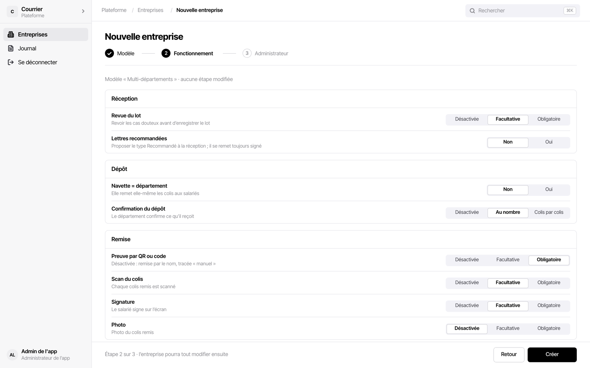
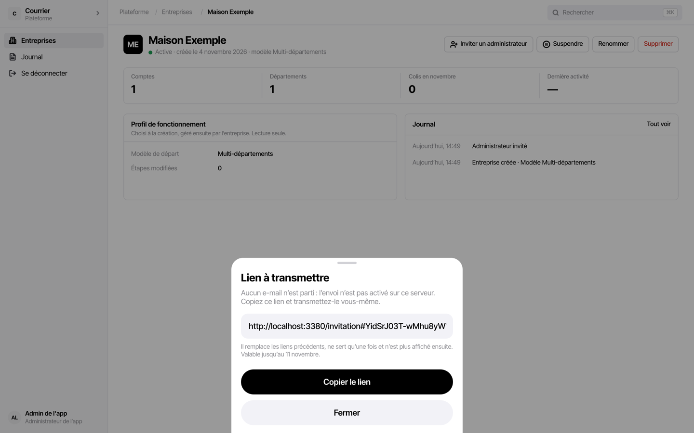

# Fiche de l'admin de l'app

L'admin de l'app gère la plateforme : il crée les entreprises clientes, invite leur premier
admin, et les suspend ou les supprime. Il travaille sur ordinateur.

**Il ne voit que des chiffres** : ni colis, ni annuaire, ni nom de salarié. Tout le
reste appartient à l'entreprise et se règle par son admin
([guide de l'admin entreprise](admin-entreprise.md)).

## Accès

- Le premier compte se crée sur le serveur, par `auth:create-user --role platform_admin`
  (voir le README du dépôt). Il n'y en a qu'un : le script refuse d'en créer un second.
- Mot de passe perdu : `auth:reset-password`, depuis le terminal du conteneur de l'API
  ([procédure](../comptes.md#mot-de-passe-perdu-sans-admin-disponible)).

## Les écrans

| Écran | Contenu |
|---|---|
| Entreprises | une ligne par entreprise : statut, modèle de profil, départements, comptes, colis du mois, dernière activité ; filtres Actives, Suspendues, par modèle |
| Fiche d'une entreprise | les mêmes chiffres, le profil de fonctionnement en lecture, son journal ; « Inviter un administrateur », « Suspendre », « Renommer », « Supprimer » |
| Journal | les actions faites sur la plateforme, gardées 12 mois : créations, renommages, suspensions, réactivations, suppressions, invitations |

## Créer une entreprise

1. Entreprises › « Nouvelle entreprise ».
2. **Étape 1 sur 3** : le nom, et un modèle de départ :
   - **Petit site** : un seul lieu de retrait, la navette scanne et remet elle-même ;
     e-mail dès le scan, relances à la main ;
   - **Multi-départements** : chaque département a son point de réception ; dépôt confirmé
     au nombre, e-mail au dépôt, QR ou code obligatoire, relances automatiques ;
   - **Traçabilité stricte** : chaque geste prouvé ; dépôt colis par colis, scan et
     signature obligatoires.
3. **Étape 2 sur 3** : les étapes du fonctionnement, ajustables (« aucune étape modifiée »
   si on garde le modèle). L'entreprise pourra les changer ensuite.
4. « Créer ».

## Inviter le premier admin

**Étape 3 sur 3**, ou plus tard depuis la fiche : « Inviter un administrateur », avec son
nom et son adresse.

- Si l'envoi par le serveur est activé, l'invitation part par e-mail.
- Sinon, l'écran affiche « Lien à transmettre » : « Aucun e-mail n'est parti ». « Copier le
  lien » et le transmettre soi-même. Il n'est affiché qu'une fois, vaut 7 jours et sert une
  fois.

Tant que l'entreprise a un admin actif, l'invitation est refusée : c'est lui qui invite les
autres. L'admin de l'app n'invite qu'un premier admin, ou un remplaçant quand il n'y a plus
d'admin actif.

## Suspendre, renommer, supprimer

- **Suspendre** : plus personne de l'entreprise ne se connecte ni ne synchronise ; les
  téléphones gardent leurs données et affichent « Votre entreprise est suspendue ». Tout
  reprend à la réactivation.
- **Renommer** : le journal garde l'ancien nom.
- **Supprimer** : **irréversible**. Saisir le nom exact de l'entreprise. Elle part avec
  ses colis, son annuaire et ses comptes ; les téléphones s'effacent à leur requête
  suivante. Le journal de la plateforme en garde la trace.

## Envoi des e-mails par le serveur

L'envoi par le serveur vaut pour toutes les entreprises à la fois. Tant qu'il n'est pas
activé, invitations et e-mails aux salariés passent par un lien à copier et par la
messagerie des agents. Son activation, avec la clé du fournisseur d'envoi et le webhook,
est une décision à part. La procédure est dans [Mise en service du
pilote](../mise-en-service.md#2-activer-lenvoi-par-le-serveur-brevo), puis le domaine
d'envoi de chaque entreprise ([section 3](../mise-en-service.md#3-domaine-denvoi-de-lentreprise-pilote)) ;
les vérifications après activation, dans la partie 9 de la
[recette](../recette.md#9-ce-qui-attend-lactivation-de-brevo).
