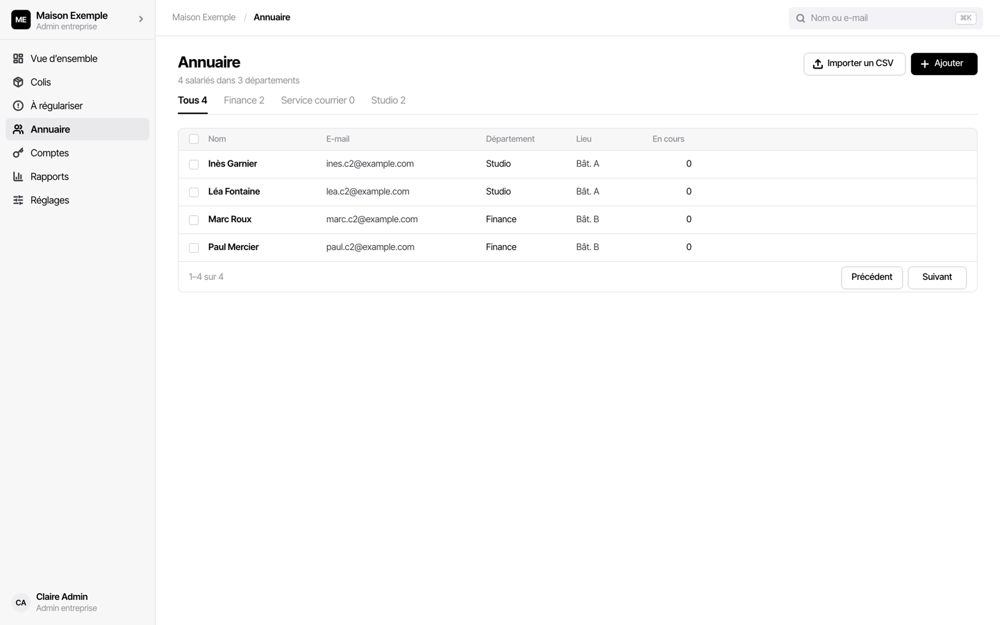
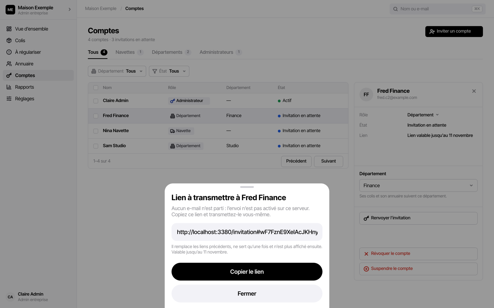
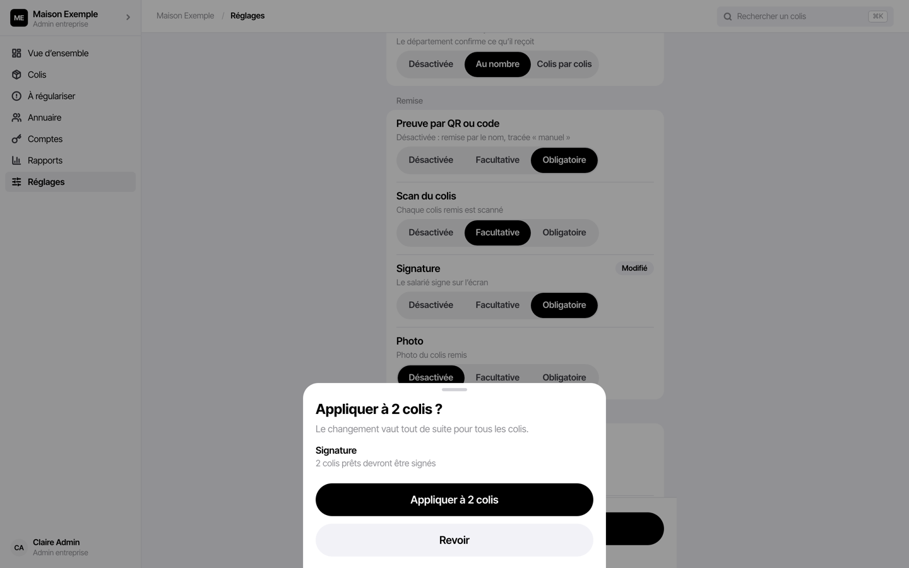
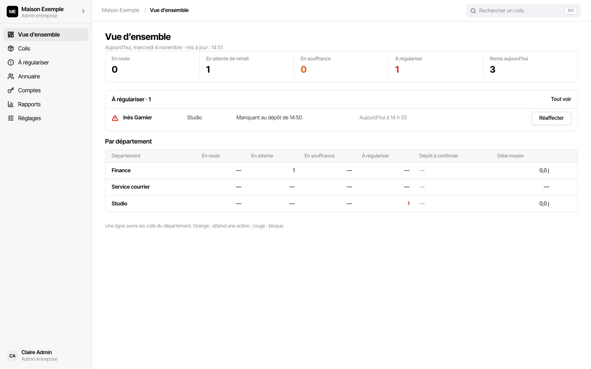
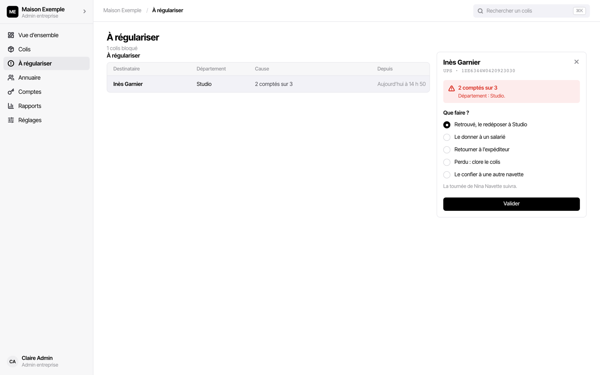

# Guide de l'admin entreprise

L'admin entreprise règle l'app pour son entreprise : départements et annuaire, comptes,
fonctionnement, e-mails. Il suit ensuite les colis de toute l'entreprise et tranche les
écarts. Il travaille sur **ordinateur** de préférence ; sur iPhone, il retrouve les colis,
la vue d'ensemble et les rapports depuis Réglages.

Il ne remet pas les colis aux salariés : c'est le rôle des départements (ou de la navette
sur un petit site). Sur iPhone, il peut scanner des colis à la réception.

L'entreprise est créée par l'admin de l'app, qui vous invite. Les comptes, mots de passe et
suspensions sont détaillés dans [Comptes de l'entreprise](../comptes.md).

## Sommaire

- [Le premier jour, dans l'ordre](#le-premier-jour-dans-lordre)
- [Départements et annuaire](#départements-et-annuaire)
- [Inviter les comptes](#inviter-les-comptes)
- [Le fonctionnement](#le-fonctionnement)
- [Les e-mails aux salariés](#les-e-mails-aux-salariés)
- [Chaque jour : la vue d'ensemble](#chaque-jour--la-vue-densemble)
- [Régulariser un colis](#régulariser-un-colis)
- [Rapports et export](#rapports-et-export)
- [Gérer les comptes](#gérer-les-comptes)
- [Téléphone perdu ou volé](#téléphone-perdu-ou-volé)
- [Conservation des données](#conservation-des-données)

## Le premier jour, dans l'ordre

1. **Choisir son mot de passe** par le lien d'invitation (12 caractères au moins), puis se
   connecter.
2. **Identité** : Réglages › Identité et e-mails : nom et logo de l'entreprise, affichés
   dans l'app et en tête des e-mails ; adresse de réception et noms sur les étiquettes, qui
   signalent un colis adressé ailleurs.
3. **Départements et annuaire** : importer le CSV des salariés, qui crée les départements
   ([ci-dessous](#départements-et-annuaire)).
4. **Lieu et horaires de retrait** : Réglages › Lieu et horaires de retrait. Ils
   apparaissent dans chaque e-mail ; vides, leurs lignes sont retirées de l'e-mail.
5. **Fonctionnement** : vérifier les étapes choisies à la création
   ([ci-dessous](#le-fonctionnement)).
6. **Affiches QR** : Réglages › Affiche QR du département, un département à la fois,
   « Imprimer ». Poser chaque affiche au point de réception du département : la navette la
   vise pour déposer.
7. **Inviter les comptes** : navettes, départements, autres admins
   ([ci-dessous](#inviter-les-comptes)).
8. **Faire installer l'app** sur les iPhone : [Installer l'app sur
   l'iPhone](../installation-iphone.md). Puis remettre à chacun son guide : [navette](navette.md),
   [département](departement.md).

## Départements et annuaire

**Annuaire** liste tous les salariés, par département, avec leurs colis en cours. Onglets :
Tous, un par département, **Sans département**, **Hors annuaire** (contacts saisis à la
réception), **Demandes** (déplacements demandés par un département).



**Créer les départements** : par l'import CSV seulement. Il n'y a pas encore d'écran pour
créer un département seul ; pour en ajouter un plus tard, importer un CSV qui le cite.
Le département « Service courrier » existe d'office.

1. Préparer un fichier CSV, séparé par des points-virgules (ou des virgules), avec ces
   colonnes :

   ```csv
   prénom;nom;email;département;lieu
   Léa;Fontaine;lea.fontaine@exemple.fr;Studio;Bât. A
   Marc;Roux;marc.roux@exemple.fr;Finance;Bât. B
   ```

2. Annuaire › « Importer un CSV », choisir le fichier.
3. Pour chaque département inconnu (« « Studio » n'existe pas encore ») : « Créer
   « Studio » ».
4. Relire : À ajouter, À mettre à jour, Déjà à jour, Lignes en erreur (nom manquant,
   e-mail incomplet, département inconnu…).
5. « Importer N salariés ».

Réimporter le même fichier met l'annuaire à jour sans doublon. Ensuite :

- « Ajouter » : un salarié seul.
- Un salarié qui change de département : sa fiche, « Déplacer vers un autre département ».
  L'écran dit ce qui suit (« 1 colis à venir ira à Finance », ou colis à régulariser).
- Les demandes de déplacement des départements arrivent dans **Demandes** : déplacer, ou
  « Classer la demande ».

## Inviter les comptes

Chaque personne a son compte. Un compte de département est rattaché à un seul département.

1. **Comptes** › « Inviter un compte ».
2. Rôle : Navette, Département (choisir le département) ou Admin ; nom et adresse.
3. « Envoyer l'invitation ».

Si l'envoi par le serveur est activé, l'invitation part par e-mail. Sinon, l'écran affiche
« Lien à transmettre à … » : copiez-le et transmettez-le vous-même (il n'est affiché
qu'une fois). Le lien vaut 7 jours et sert une fois ; on peut en renvoyer un autre.



La liste montre l'état de chacun : Actif, Invitation en attente, Invitation expirée,
Suspendu, Révoqué, et la dernière connexion.

## Le fonctionnement

Réglages › **Fonctionnement** fixe ce que l'app demande à chaque étape. Il part du modèle
choisi à la création (Petit site, Multi-départements ou Traçabilité stricte), et se modifie
étape par étape.

| Section | Réglage | Choix |
|---|---|---|
| Réception | Revue du lot : revoir les cas douteux avant d'enregistrer | Désactivée, Facultative, Obligatoire |
| Réception | Lettres recommandées : type Recommandé à la réception, toujours remis signé | Non, Oui |
| Dépôt | Navette = département : la navette remet elle-même | Non, Oui |
| Dépôt | Confirmation du dépôt par le département | Désactivée, Au nombre, Colis par colis |
| Remise | Preuve par QR ou code (désactivée : remise par le nom) | Désactivée, Facultative, Obligatoire |
| Remise | Scan du colis remis | Désactivée, Facultative, Obligatoire |
| Remise | Signature du salarié | Désactivée, Facultative, Obligatoire |
| Remise | Photo du colis remis | Désactivée, Facultative, Obligatoire |
| E-mails | Moment de l'e-mail | Au scan, Au dépôt |
| E-mails | Relances | Désactivées, À la main, Automatiques |

Changer une étape : « Modifié » s'affiche, puis « Enregistrer 1 changement ». Avant
d'enregistrer, l'app dit ce que le changement touche (« Appliquer à 2 colis ? », « 2 colis
prêts devront être signés ») : « Appliquer », ou « Revoir ».



**Le changement vaut tout de suite pour tous les colis**, y compris ceux déjà en cours. Il
arrive sur les téléphones à leur synchronisation suivante. Prévenez les équipes avant de
rendre une étape obligatoire.

## Les e-mails aux salariés

Les e-mails partent de deux façons :

- **par le serveur**, seuls, au moment choisi dans le fonctionnement, avec relances
  automatiques si elles sont réglées ainsi ;
- **par la messagerie** du téléphone ou de l'ordinateur de l'agent, qui ouvre chaque e-mail
  prérempli et l'envoie lui-même.

Réglages › Identité et e-mails › **Expéditeur des e-mails** dit où en est votre entreprise.
Tant qu'il affiche « Envoi par le serveur pas encore activé », seule la messagerie marche :
l'expéditeur saisi est gardé pour plus tard. L'activation se décide avec l'équipe qui
exploite l'app ; une fois faite, déclarez le domaine d'envoi, posez les enregistrements DNS
indiqués et « Vérifier maintenant ».

Sous **Réponses aux e-mails**, chaque département peut avoir une adresse partagée qui reçoit
les réponses des salariés ; vide, c'est le compte le plus ancien du département.

Les modèles d'e-mail sont **par compte** (Réglages › Modèles d'e-mail). Le modèle livré parle
du « service courrier » : demandez aux départements de l'adapter, voir le
[guide du département](departement.md#le-modèle-de-mail-par-défaut).

## Chaque jour : la vue d'ensemble

**Vue d'ensemble** donne les chiffres du jour : En route, En attente de retrait, En
souffrance, À régulariser, Remis aujourd'hui ; puis un tableau **par département** (dépôts
à confirmer, délai moyen). Une ligne ouvre les colis du département. Orange : attend une
action ; rouge : bloque.



Les chiffres sont calculés sur l'appareil, aussi frais que sa dernière synchronisation :
l'heure est indiquée (« mis à jour : 14:47 »).

**Colis** liste tous les colis de l'entreprise ; **Réglages › Journal des remises** toutes
les remises, avec leur preuve.

## Régulariser un colis

Un colis passe **À régulariser** quand un département signale un écart au dépôt, ou quand
plus aucun département ne peut le prendre (salarié parti, déplacé). La page **À
régulariser** les liste, avec leur cause (« 2 comptés sur 3 », « Salarié parti »…).

1. Toucher le colis : « Que faire ? ».
2. Choisir :
   - **Retrouvé, le redéposer à Studio** : il revient dans la tournée de la navette ;
   - **Le confier à un département**, ou **Le donner à un salarié** ;
   - **Le confier à une autre navette** ;
   - **Retourner à l'expéditeur** ;
   - **Perdu : clore le colis**.
3. « Valider ».



## Rapports et export

**Rapports** (sur iPhone : Réglages › Pilotage › Rapports et export) : colis reçus, remis,
écarts au dépôt, preuve la plus utilisée, par département et par transporteur.

- Période : Semaine, Mois, Trimestre ; département : tous ou un seul.
- « Exporter en CSV » : un fichier lisible dans Excel (feuille de partage sur iPhone).
- « Rapport PDF » : la page sans ses commandes, à enregistrer en PDF depuis l'impression.

L'export demande une connexion.

## Gérer les comptes

Dans **Comptes**, ouvrir un compte :

| Geste | Effet |
|---|---|
| Renvoyer un lien de mot de passe | il choisit un nouveau mot de passe ; l'ancien lien ne marche plus |
| Changer le mot de passe | mot de passe provisoire à lui transmettre, à changer à sa prochaine connexion ; son téléphone continue de marcher |
| Suspendre le compte | plus de connexion ; ses données restent sur son téléphone, tout reprend à la réactivation |
| Révoquer le compte | plus de connexion ; **son téléphone est effacé**, photos et preuves comprises |
| Changer le rôle | navette, département ou admin |

En changeant un mot de passe, **ne cochez pas la fermeture des sessions** sauf mot de passe
compromis : elle efface les téléphones du compte. Le dernier admin actif ne peut être ni
suspendu ni révoqué. Le détail : [Comptes de l'entreprise](../comptes.md).

## Téléphone perdu ou volé

Réglages › **Appareils connectés** liste les sessions ouvertes. Déconnecter l'appareil
perdu : il revient à l'écran de connexion et s'efface dès qu'il retrouve le réseau. La
procédure complète est dans [En cas de perte ou de
vol](../installation-iphone.md#en-cas-de-perte-ou-de-vol).

## Conservation des données

Réglages › **Conservation** fixe combien de temps sont gardées les photos d'étiquettes, les
données de lecture, les colis remis et leur journal, les signatures, les contacts hors
annuaire et l'historique des e-mails. Au-delà, elles sont effacées à la purge suivante. À
valider avec votre DPO ; « Exporter avant la purge » garde une copie.
