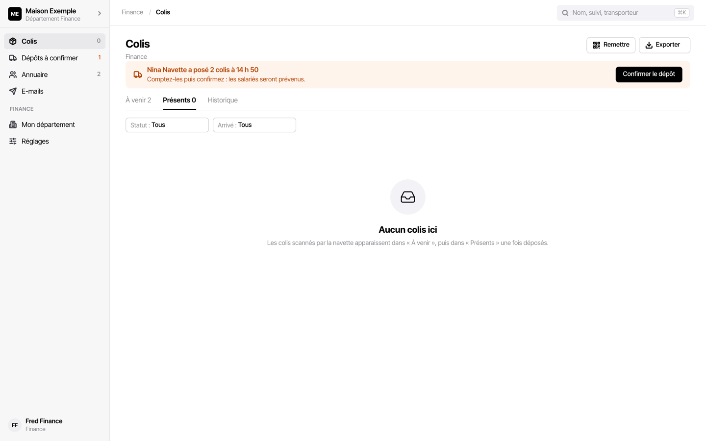
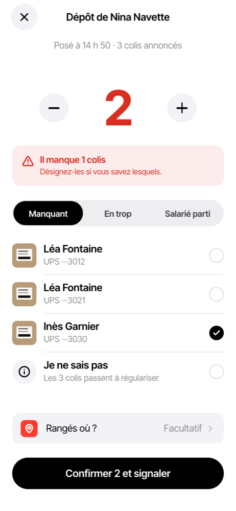
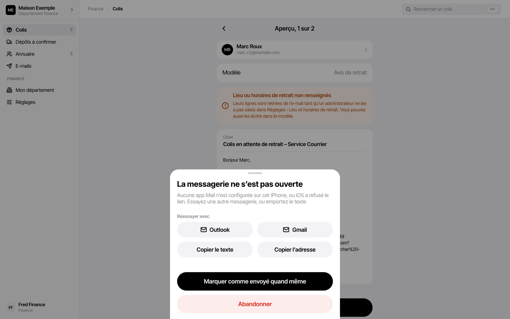
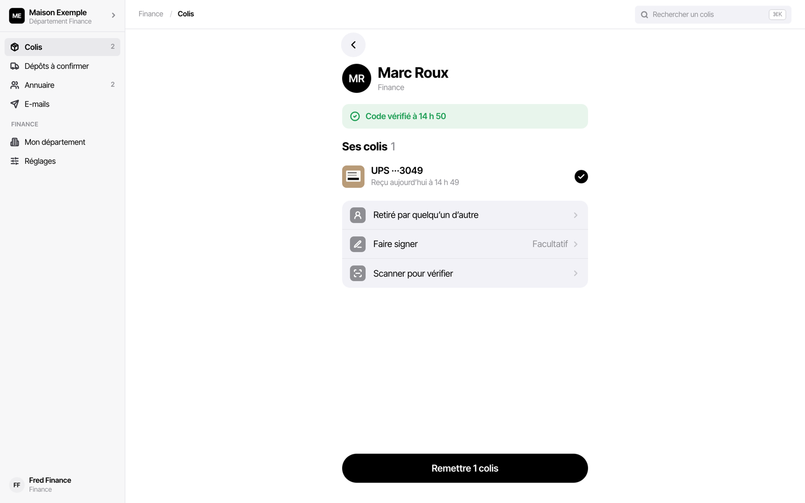

# Guide du département

Un département reçoit les colis que la navette dépose à son point de réception, prévient
chaque salarié et lui remet son colis. Un département a plusieurs comptes : chacun a le
sien, et tous voient les mêmes colis. Le service courrier est un département comme un
autre.

Un compte de département ne voit que les colis et l'annuaire de son département. Il
travaille sur **ordinateur** (dans le navigateur) ou sur **iPhone** (app installée) ; les
deux montrent les mêmes données. Il ne scanne pas les colis à l'arrivée : c'est le rôle de
la navette.

Ce qui est demandé à chaque étape (confirmer le dépôt, prouver la remise, faire signer…)
dépend du **fonctionnement** réglé par l'admin de l'entreprise. Ce guide décrit tous les
cas ; l'écran n'affiche que ce qui s'applique chez vous.

## Sommaire

- [Le premier jour](#le-premier-jour)
- [Les écrans](#les-écrans)
- [Confirmer un dépôt](#confirmer-un-dépôt)
- [Prévenir les salariés](#prévenir-les-salariés)
- [Relancer](#relancer)
- [Quand le salarié répond](#quand-le-salarié-répond)
- [Remettre un colis](#remettre-un-colis)
- [Annuler une remise, retourner un colis](#annuler-une-remise-retourner-un-colis)
- [L'annuaire du département](#lannuaire-du-département)
- [Dépannage](#dépannage)

## Le premier jour

1. Ouvrir le **lien d'invitation** reçu par e-mail ou transmis par l'admin de l'entreprise,
   choisir un mot de passe de 12 caractères au moins, « Créer mon mot de passe ».
2. **Sur ordinateur** : se connecter à l'adresse de l'app dans le navigateur.
   **Sur iPhone** : installer l'app d'abord ([Installer l'app sur
   l'iPhone](../installation-iphone.md)), ouvrir le lien dans Safari, puis se connecter
   dans l'app installée.
3. Vérifier dans **Mon département** (ordinateur) ou Réglages › Lieu et horaires (iPhone)
   le lieu et les horaires de retrait : ce sont ceux que les e-mails donnent aux salariés.
   Ils sont en lecture ; s'ils sont faux ou vides, demandez à l'admin de l'entreprise.
4. Vérifier le texte des e-mails : voir
   [Le modèle d'e-mail par défaut](#le-modèle-de-mail-par-défaut).

Un compte qui n'est rattaché à aucun département ne voit rien et affiche « Ce compte n'est
rattaché à aucun département » : l'admin de l'entreprise doit le rattacher.

## Les écrans

**Sur ordinateur**, le menu de gauche :

| Entrée | Ce qu'on y trouve |
|---|---|
| Colis | trois onglets : **À venir** (en route vers vous), **Présents** (déposés, à prévenir ou à retirer), **Historique** (remis, retournés, à régulariser) ; « Remettre », « Exporter » |
| Dépôts à confirmer | les dépôts de la navette, avec leur état |
| Annuaire | les salariés du département |
| E-mails | le suivi des e-mails envoyés |
| Mon département | lieu, horaires et consignes de retrait, en lecture |
| Réglages | modèles d'e-mail, messagerie, affiche QR, compte, version |

La recherche en haut (⌘K) trouve un colis par nom, numéro de suivi ou transporteur. Une
ligne ouvre le détail du colis à droite.

**Sur iPhone**, l'accueil est la liste **Colis**, rangée par ce qu'il y a à faire : À
notifier, Relancer, En route, En attente de retrait, Remis aujourd'hui. « Remettre » est en
bas de l'écran.

## Confirmer un dépôt

Quand la navette a posé des colis, un bandeau orange l'annonce : « Nina Navette a posé 2
colis à 14 h 50 ».

1. Compter les colis posés.
2. « Confirmer le dépôt ».
3. Le nombre y est : « Confirmer 2 colis ». C'est fini, les colis passent « Présents ».

**Le compte n'y est pas** :

1. « Le compte n'y est pas », puis « Moins » ou « Plus » jusqu'au nombre compté.
2. L'écran dit l'écart (« Il manque 1 colis »). Si vous savez lesquels, désignez-les :
   **Manquant**, **En trop**, ou **Salarié parti** (le destinataire n'est plus là). Sinon,
   « Je ne sais pas ».
3. « Confirmer 2 et signaler ».

Les colis désignés passent **À régulariser** : l'admin de l'entreprise et la navette le
voient, et c'est l'admin qui décide de la suite. Vous n'avez rien d'autre à faire.

Selon le fonctionnement, la confirmation peut se faire **colis par colis** (« Touchez
chaque colis reçu »), ou être désactivée : les colis arrivent alors directement dans
« Présents ».

Un dépôt se confirme aussi depuis l'iPhone ; la navette n'a pas besoin d'attendre.

## Prévenir les salariés

Le salarié reçoit un e-mail avec son **code de retrait à 4 chiffres** et un **QR**, le
lieu et les horaires de retrait. Selon le fonctionnement, il est prévenu à la confirmation
du dépôt, ou dès le scan par la navette.

L'e-mail part de l'une de deux façons. L'écran dit laquelle : après une confirmation,
« E-mails aux salariés » indique « 2 envoyés » ou « en cours d'envoi » (serveur), ou « 2 à
envoyer » (messagerie du téléphone).

### Si l'envoi par le serveur est activé

Les e-mails partent seuls, sans geste. Suivez-les dans **E-mails** :

| État | Sens |
|---|---|
| Envoi en cours par le serveur | il part |
| Envoyé, Délivré | il est arrivé chez le salarié |
| Échec : adresse refusée | l'adresse est fausse : la corriger dans l'annuaire, puis renvoyer |
| Pas d'adresse e-mail | le salarié n'a pas d'adresse : le prévenir autrement |

Les réponses des salariés arrivent à l'adresse de réponse du département, réglée par
l'admin de l'entreprise.

### Sinon : par la messagerie du téléphone ou de l'ordinateur

Chaque e-mail s'ouvre, prérempli, dans votre messagerie ; c'est vous qui l'envoyez.

1. Colis › **À notifier** (ou « Notifier » sur iPhone) : l'aperçu montre le salarié, le
   modèle et le texte (« Aperçu, 1 sur 2 »).
2. « Envoyer à Marc » : la messagerie s'ouvre avec l'adresse, l'objet et le texte.
3. Envoyer depuis la messagerie, puis revenir dans l'app.
4. À la question « L'e-mail est-il parti ? », répondre oui. Le colis passe « Notifié ».
   Passer au suivant.

Sur iPhone, « Partager avec le QR » joint aussi l'image du QR : choisir Mail dans la
feuille de partage. **L'adresse n'est alors pas préremplie** : la saisir, et la relire.

Le choix de la messagerie (Mail, Outlook, Gmail) se fait dans Réglages › Messagerie, avec
« Tester ». Si la messagerie ne s'ouvre pas, l'app propose une autre messagerie, « Copier
le texte », « Copier l'adresse », ou « Marquer comme envoyé quand même » si vous l'avez
envoyé par un autre moyen. Sur ordinateur, ce message peut s'afficher alors que le
brouillon s'est bien ouvert : envoyez, puis marquez comme envoyé.

> **Le code de retrait est celui du message envoyé.** Chaque ouverture de l'aperçu tire un
> nouveau code. Le code envoyé marche ; un code noté sur un aperçu antérieur, non.

Les e-mails préparés se retrouvent dans **E-mails** (Réglages › E-mails envoyés sur
iPhone) : À confirmer, Échecs, Envoyés.

### Le modèle d'e-mail par défaut

Chaque compte a ses modèles : Réglages › **Modèles d'e-mail** (« Avis de retrait »,
« Relance »). Le modèle livré parle encore du service courrier : objet « … en attente de
retrait – Service Courrier », et « Donnez votre code au comptoir du service courrier ».
Si le salarié retire son colis dans votre département, modifiez ces deux lignes dans vos
modèles avant les premiers envois. Le lieu et les horaires viennent de Mon département et
s'ajoutent seuls.

Si l'aperçu affiche « Lieu ou horaires de retrait non renseignés », ces lignes sont
retirées de l'e-mail : demandez à l'admin de l'entreprise de les saisir.

### Un salarié sans adresse e-mail

L'app demande « Comment le prévenir ? » : passer par un contact qui a une adresse, ou le
prévenir de vive voix puis « C'est fait, afficher le code », et lui donner le code.

## Relancer

Un colis qui attend trop longtemps passe dans **Relancer**, puis **En souffrance**.

- Relances **automatiques** avec l'envoi par le serveur : elles partent seules.
- Sinon, les relances sont proposées à J+2 et J+5 jours ouvrés. « Relancer » ouvre
  l'e-mail de relance dans votre messagerie, comme pour le premier envoi.

## Quand le salarié répond

Sur la fiche du colis, « Le salarié a répondu » propose :

| Réponse | Effet |
|---|---|
| Ce n'est pas pour moi | le colis repasse à compléter |
| Un collègue passe le prendre | son nom sera proposé à la remise |
| Absence jusqu'au … | pas de relance avant son retour |
| Envoyer une copie à un collègue | même QR et même code de retrait, pour un délégué |

## Remettre un colis

1. « Remettre ».
2. Le salarié montre son **QR** (viser avec la caméra), ou donne son **code** (« Taper le
   code »). Sans l'un ni l'autre : « Chercher un nom », si le fonctionnement le permet.
3. L'écran affiche « Code vérifié », le nom et ses colis.
4. Selon le fonctionnement : « Faire signer », photo, « Scanner pour vérifier » chaque
   colis. Ce qui est marqué **Obligatoire** bloque « Remettre » tant que ce n'est pas fait.
   « Retiré par quelqu'un d'autre » si un collègue le prend à sa place.
5. « Remettre 1 colis » : « 1 colis remis », « Remise enregistrée ».

Un code d'un autre département est refusé : « Ce code est pour Studio… Rien n'a été
remis ». Un code expiré ou déjà servi : chercher le nom. Si la preuve par QR ou code est
obligatoire et que le salarié n'a ni l'un ni l'autre, faites signer ; si la signature est
aussi désactivée, la remise attend son code.

La signature et la photo restent sur l'appareil qui a remis.

## Annuler une remise, retourner un colis

- **Remise faite par erreur** : sur la fiche du colis, « Annuler la remise », avec le motif
  (mauvais colis, mauvaise personne, erreur de saisie). Le colis revient en attente de
  retrait.
- **Colis jamais retiré, refusé, salarié parti** : sur la fiche, « Retourner à
  l'expéditeur ». Si la navette doit le reprendre, il passe en « Retour en cours » jusqu'à
  son passage ; sinon il quitte la liste. Son code de retrait se ferme.

## L'annuaire du département

**Annuaire** liste les salariés du département, avec leur adresse et leurs colis en cours.
L'admin de l'entreprise le voit aussi.

- « Ajouter un salarié » : nom, adresse, lieu.
- Un salarié qui a changé de département : ouvrir sa fiche, « Demander le déplacement ».
  L'admin de l'entreprise reçoit la demande et le déplace.

Une adresse fausse corrigée ici vaut pour les envois suivants.

## Dépannage

| Problème | Que faire |
|---|---|
| Un dépôt annoncé n'apparaît pas | attendre la synchronisation (pastille « À jour » sur iPhone) ; la navette peut être hors ligne, il arrivera à son retour de réseau |
| Le salarié n'a pas reçu l'e-mail | E-mails : vérifier l'état et l'adresse ; renvoyer, ou lui donner le code de vive voix |
| « Code inconnu ici » | le code est peut-être d'un autre département : le vérifier avec le salarié |
| « Ce code a été remplacé par un e-mail plus récent » | demander le code du dernier e-mail reçu |
| Lieu ou horaires faux dans l'e-mail | l'admin de l'entreprise les corrige ; le modèle se corrige dans Réglages › Modèles d'e-mail |
| « Compte suspendu » | l'admin de l'entreprise a suspendu le compte ; sur iPhone, les données restent et tout reprend à la réactivation |
| Mot de passe oublié | demander un nouveau lien à l'admin de l'entreprise |
