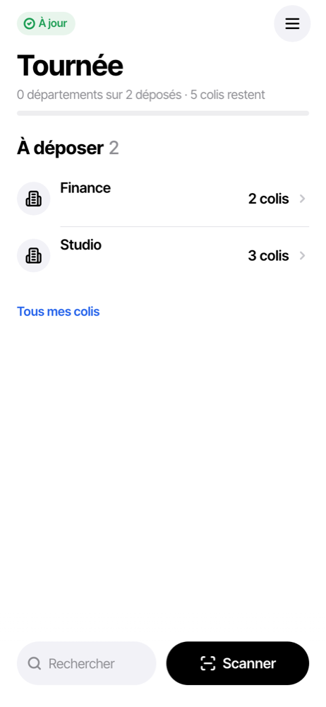
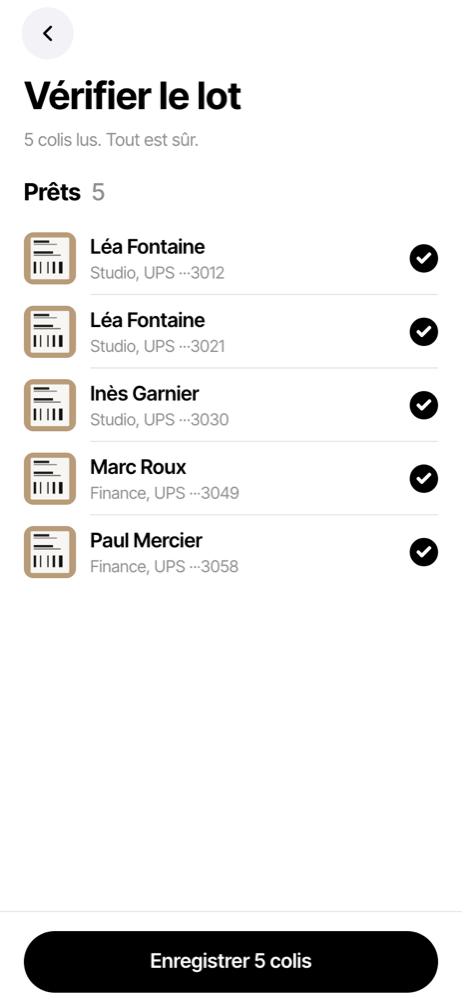
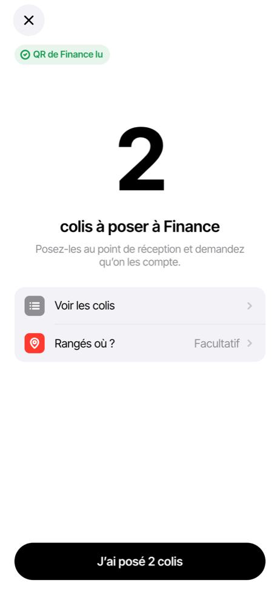
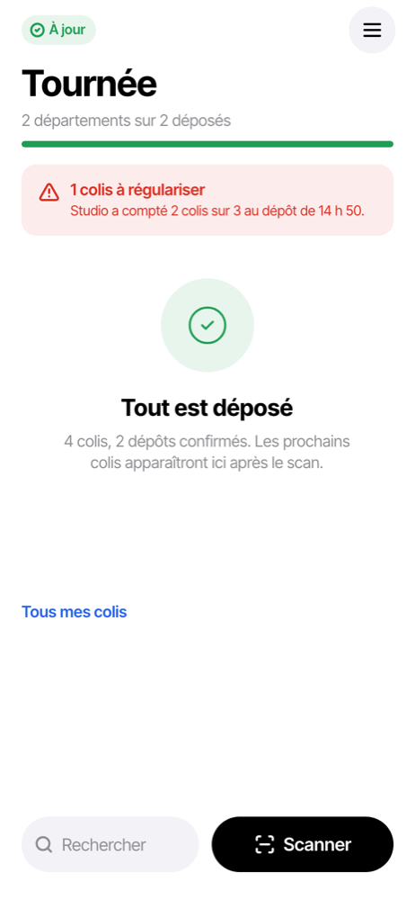

# Guide de la navette

La navette reçoit les colis à leur arrivée dans l'entreprise, les scanne avec son iPhone et
les dépose dans le département de chaque destinataire. Elle travaille sur iPhone, avec ou
sans réseau.

Ce que la navette fait exactement dépend du **fonctionnement** que l'admin de l'entreprise
a choisi. Le cas le plus courant (modèle « Multi-départements ») : la navette scanne, dépose
dans chaque département, et le département confirme puis remet. Sur un petit site, la
navette remet elle-même : voir [Si la navette remet elle-même](#si-la-navette-remet-elle-même).

## Sommaire

- [Le premier jour](#le-premier-jour)
- [L'accueil : la tournée](#laccueil--la-tournée)
- [Scanner les colis reçus](#scanner-les-colis-reçus)
- [Vérifier le lot](#vérifier-le-lot)
- [Déposer dans un département](#déposer-dans-un-département)
- [Quand le compte n'y est pas](#quand-le-compte-ny-est-pas)
- [Les autres tâches de la tournée](#les-autres-tâches-de-la-tournée)
- [Si la navette remet elle-même](#si-la-navette-remet-elle-même)
- [Sans réseau](#sans-réseau)
- [Dépannage](#dépannage)

## Le premier jour

1. **Installer l'app** sur l'iPhone : [Installer l'app sur l'iPhone](../installation-iphone.md).
2. **Ouvrir le lien d'invitation** dans Safari (reçu par e-mail ou transmis par l'admin de
   l'entreprise), choisir un mot de passe de 12 caractères au moins, « Créer mon mot de
   passe ».
3. **Se connecter dans l'app installée**, pas dans Safari.
4. **Attendre la préparation** : l'app télécharge l'annuaire et la lecture des étiquettes
   pour marcher sans réseau, puis « Continuer ». Faites-le en Wi-Fi.
5. **Autoriser la caméra** au premier scan.

Un iPhone = un compte. Ne vous déconnectez pas d'un iPhone qui a des colis en cours : les
photos ne sont que sur lui.

## L'accueil : la tournée

L'accueil s'appelle **Tournée**. Il range les colis à déposer **par département**, avec le
nombre de colis de chacun, et dit où vous en êtes (« 0 départements sur 2 déposés · 5 colis
restent »).

- **Scanner** : recevoir de nouveaux colis.
- **Rechercher** : retrouver un colis par nom, numéro de suivi, expéditeur ou transporteur.
- **Tous mes colis** : la liste complète, par état (En route, En attente de retrait,
  Remis…).
- Le menu en haut à droite ouvre les **Réglages** : synchronisation, version de l'app, son
  au scan, compte.

Sans colis : « Rien à déposer ». Une fois tous les dépôts faits : « Tout est déposé ».

## Scanner les colis reçus

1. « Scanner », puis viser l'étiquette du transporteur. Un bip confirme la lecture et le
   compteur monte (« Lot : 1 colis »).
2. Étiquette illisible : « Saisir le numéro » et taper le numéro de suivi.
3. Scanner les colis suivants, puis « Terminer ».

Si l'app se ferme pendant le scan, rien n'est perdu : à la réouverture, « Reprendre le
lot ? » propose de continuer.

Si votre entreprise traite les lettres recommandées, le type « Recommandé » est proposé à
la réception ; une lettre recommandée se remet toujours signée.

## Vérifier le lot

L'écran « Vérifier le lot » montre ce que l'app a lu. Les colis sûrs sont « Prêts » ; les
autres demandent votre avis (destinataire incertain, numéro à vérifier, transporteur
inconnu…).

1. Toucher un colis douteux. Pour le destinataire, « Chercher dans l'annuaire » : le
   département s'affiche à côté du nom, c'est lui qui recevra le colis.
2. « Valider et suivant » jusqu'à « Tout est sûr ».
3. « Enregistrer N colis ».

Un colis qu'on ne peut pas compléter tout de suite part dans **À compléter** : il n'est ni
mis en route ni annoncé au salarié tant qu'il n'est pas complété (depuis « Tous mes colis »,
« Compléter »).

L'écran du lot enregistré dit la suite : « N en route, à déposer dans leur département ».
Si votre entreprise prévient le salarié **dès le scan**, il dit aussi ce qu'il en est des
e-mails :

- « N e-mails partent tout seuls » : le serveur les envoie, rien à faire ;
- « N e-mails prêts », « Envoyer N e-mails » : l'envoi se fait par la messagerie de
  l'iPhone, comme décrit dans le [guide du département](departement.md#prévenir-les-salariés).

Si elle prévient **au dépôt**, aucun e-mail ne vous concerne : le département s'en charge.

## Déposer dans un département

Chaque département a une **affiche QR** à son point de réception, imprimée par l'admin de
l'entreprise.

1. Dans la tournée, toucher le département, puis « Déposer à Finance » (par exemple).
2. Viser l'affiche QR : « QR de Finance lu ». Sans affiche lisible : « Choisir dans la
   liste », puis le département.
3. Poser les colis. « Rangés où ? » (facultatif) note l'endroit.
4. « J'ai posé 2 colis ».

Si le département confirme les dépôts, l'écran affiche « À Finance de confirmer » : inutile
d'attendre, « Continuer la tournée ». La confirmation arrivera dans la tournée (« à
confirmer », puis « confirmé à … »). Si la confirmation est désactivée, le dépôt est fait
tout de suite : « 2 colis déposés à Finance ».

## Quand le compte n'y est pas

Le département compte ce que vous avez posé. S'il en manque, ou s'il y en a trop, il le
signale : le colis passe **À régulariser**, et la tournée l'affiche en rouge (« 1 colis à
régulariser · Studio a compté 2 colis sur 3 »).

Vous n'avez rien à décider : c'est l'admin de l'entreprise qui tranche
([Régulariser un colis](admin-entreprise.md#régulariser-un-colis)). S'il retrouve le
colis et choisit de le redéposer, celui-ci revient dans votre tournée, à déposer de nouveau.
S'il est avec vous, dites-le-lui.

## Les autres tâches de la tournée

Selon les cas, la tournée affiche aussi :

| Ligne | Ce que c'est | Geste |
|---|---|---|
| À compléter avant de partir | colis enregistrés sans destinataire ou sans département | les ouvrir et compléter |
| Reçus, pas encore en route | colis enregistrés mais pas mis en tournée | « Mettre en route » |
| Sans navette | colis d'une autre navette qui n'est plus là | « Les prendre » |
| Retour à reprendre | colis qu'un département renvoie à l'expéditeur | « Reprendre » au département |
| À rendre à l'expéditeur | colis repris, à remettre au transporteur | « C'est rendu » une fois remis |

## Si la navette remet elle-même

Sur un petit site (modèle « Petit site », réglage « Navette = département »), il n'y a pas
de dépôt : la navette scanne, prévient les salariés et leur remet leurs colis. L'accueil n'est
plus la tournée mais la liste **Colis** (À notifier, À retirer, Remis aujourd'hui), la même
que celle du département sur iPhone.

Pour prévenir et remettre, suivez le [guide du département](departement.md) : sections
[Prévenir les salariés](departement.md#prévenir-les-salariés) et
[Remettre un colis](departement.md#remettre-un-colis), ainsi que
[Relancer](departement.md#relancer) et
[Quand le salarié répond](departement.md#quand-le-salarié-répond). Le salarié est prévenu
dès la réception. Deux points à connaître avant le premier envoi :

- le modèle d'e-mail livré parle du service courrier : adaptez-le
  ([détail](departement.md#le-modèle-de-mail-par-défaut)) ;
- chaque ouverture de l'aperçu tire un nouveau code de retrait : le bon est celui du
  message envoyé.

## Sans réseau

L'app marche sans réseau : scan, lot, dépôt. La pastille en haut de l'accueil dit l'état
(« À jour », ou le nombre de modifications en attente). Tout part dès que le réseau revient,
sans geste. Le QR du département se lit aussi hors ligne.

N'effacez pas l'app et ne vous déconnectez pas tant que des modifications attendent :
Réglages › Synchronisation les montre.

## Dépannage

| Problème | Que faire |
|---|---|
| La caméra ne s'ouvre pas | [Dépannage du guide d'installation](../installation-iphone.md#dépannage) |
| Le nom lu n'est pas dans l'annuaire | « Chercher dans l'annuaire » sous une autre orthographe ; sinon laisser le colis À compléter et prévenir l'admin de l'entreprise |
| Le QR du département ne se lit pas | « Choisir dans la liste » ; signaler l'affiche abîmée à l'admin |
| Un département n'apparaît pas | il n'existe pas encore : l'admin de l'entreprise doit le créer |
| « Compte suspendu » | l'admin de l'entreprise a suspendu le compte ; les données restent sur l'iPhone et tout reprend à la réactivation |
| Mot de passe oublié | demander un nouveau lien à l'admin de l'entreprise |
| Rien ne se met à jour | Réglages › Synchronisation et Serveur ; puis « Forcer la mise à jour » si une nouvelle version est annoncée |
