# Installer l'app sur l'iPhone du service

Ce guide s'adresse au service courrier et à la DSI. Il explique comment installer l'app
sur un iPhone, quels réglages de l'iPhone garder, et quoi faire en cas de perte, de vol
ou de changement d'iPhone.

L'app ne passe pas par l'App Store ni par un outil de gestion des appareils (MDM) :
elle s'installe depuis Safari, en l'ajoutant à l'écran d'accueil. Comptez cinq minutes
par iPhone.

## Sommaire

- [Avant de commencer](#avant-de-commencer)
- [Installer l'app pas à pas](#installer-lapp-pas-à-pas)
- [Réglages de l'iPhone recommandés](#réglages-de-liphone-recommandés)
- [En cas de perte ou de vol](#en-cas-de-perte-ou-de-vol)
- [Changer d'iPhone ou réinstaller](#changer-diphone-ou-réinstaller)
- [Dépannage](#dépannage)
- [Vérification](#vérification)

## Avant de commencer

Il faut :

- **un iPhone du service**, à jour en **iOS 26** ou plus récent
  (Réglages › Général › Informations › Version d'iOS) ;
- **Safari** : l'installation ne fonctionne pas depuis Chrome ou un autre navigateur ;
- **une connexion Wi-Fi** pour la première ouverture : l'app télécharge environ 30 Mo
  pour fonctionner ensuite sans réseau ;
- **un lien d'invitation**, reçu par e-mail ou transmis par l'administrateur. Ouvert dans
  Safari, il sert à choisir son mot de passe. Il n'y a pas d'inscription depuis l'app.

Chaque agent a son propre compte, même s'il partage un iPhone avec un collègue : c'est ce
qui permet de savoir qui a reçu ou remis un colis.

## Installer l'app pas à pas

### 1. Ouvrir l'adresse de l'app dans Safari

Sur l'iPhone, ouvrez Safari et tapez l'adresse de l'app communiquée par la DSI.

Depuis un ordinateur, la même adresse affiche une page avec un QR code : visez-le avec
l'appareil photo de l'iPhone et touchez le lien qui apparaît. Il s'ouvre dans Safari.

Tant que l'app n'est pas installée, Safari affiche la page d'installation, qui rappelle
les trois gestes à faire.

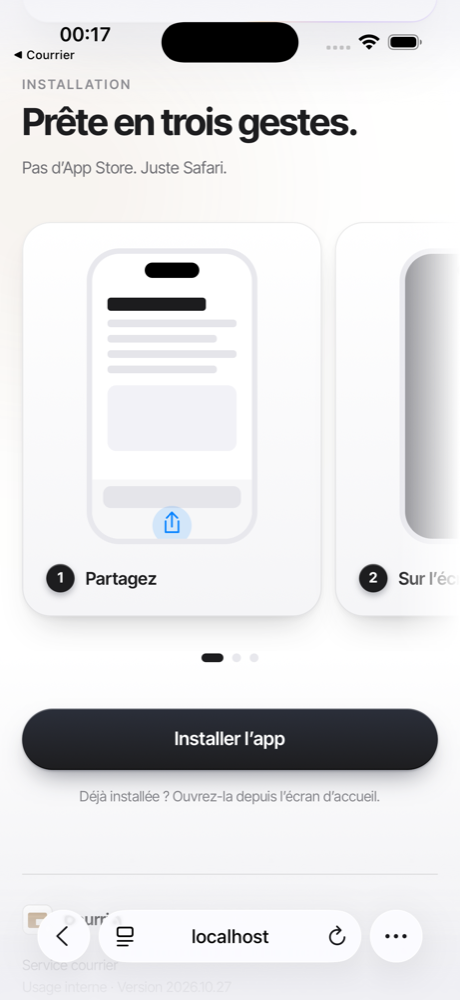

### 2. Ajouter l'app à l'écran d'accueil

1. Touchez le bouton **⋯** en bas à droite de Safari, puis **Partager**.

   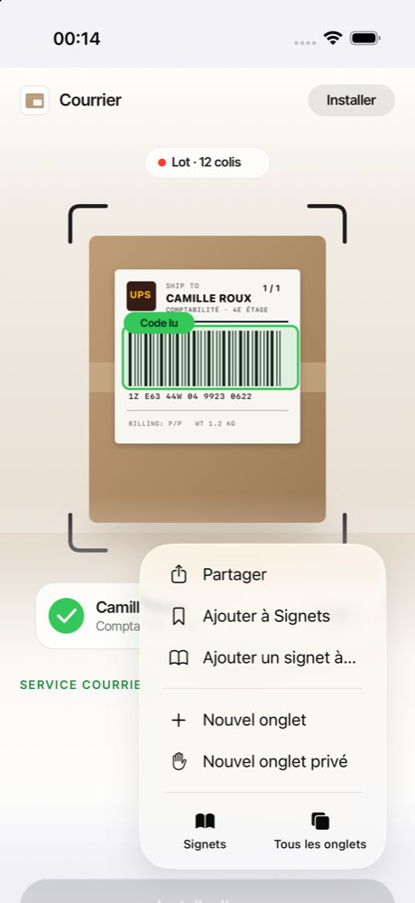

2. Dans la feuille de partage, touchez **En voir plus**.

   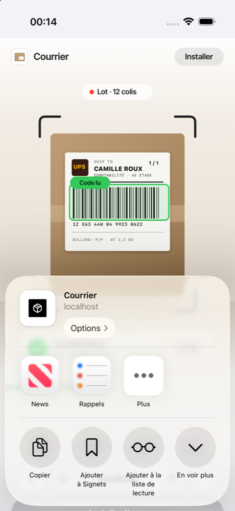

3. Touchez **Sur l'écran d'accueil**.

   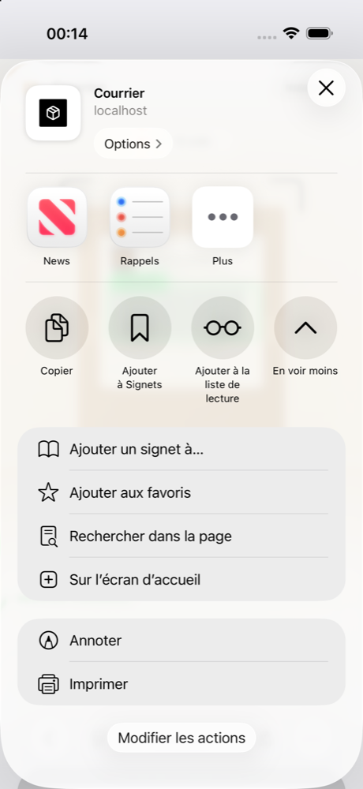

4. Laissez **Ouvrir comme app web** activé, puis touchez **Ajouter**.

   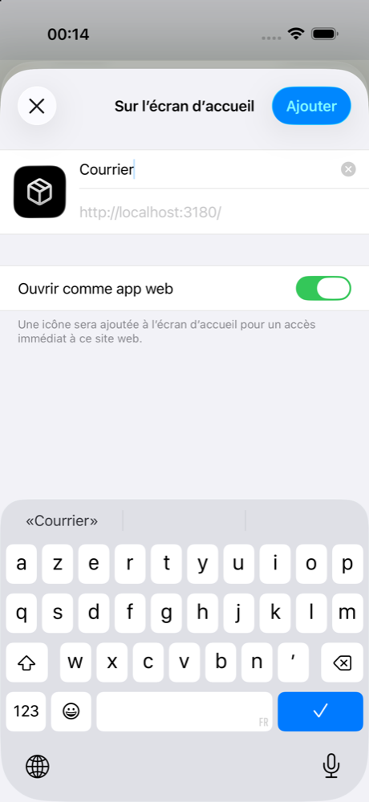

L'icône noire au pictogramme de colis apparaît sur l'écran d'accueil.

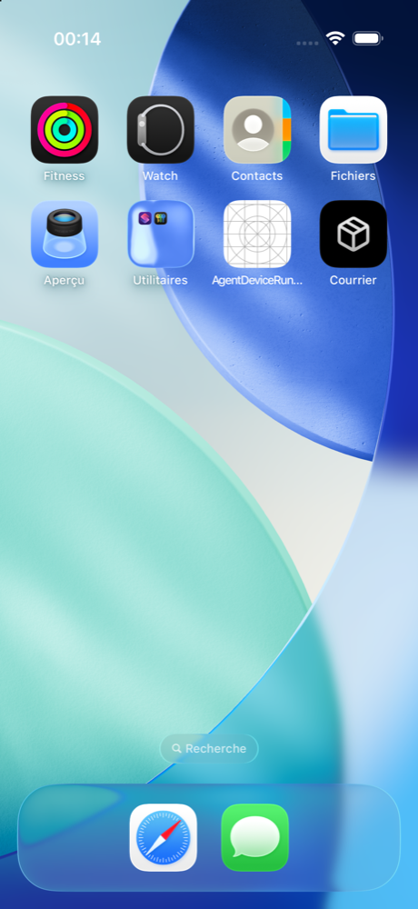

À partir de maintenant, ouvrez toujours l'app **depuis cette icône**, jamais depuis
Safari.

### 3. Première ouverture et connexion

Touchez l'icône. L'app s'ouvre en plein écran, sans la barre de Safari, sur l'écran de
connexion. Saisissez l'adresse e-mail et le mot de passe du compte, puis touchez
**Se connecter**. Si l'administrateur vous a transmis un mot de passe provisoire, l'app demande
d'en choisir un autre avant de continuer.

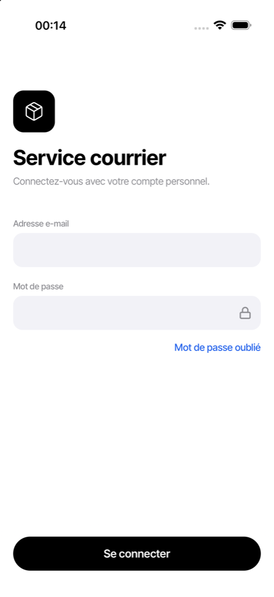

iOS propose ensuite d'enregistrer le mot de passe : c'est au choix de l'agent.

### 4. Préparation hors ligne

À la première connexion, l'app télécharge l'annuaire, la lecture des étiquettes et ses
écrans. Restez en Wi-Fi jusqu'à ce que les trois lignes soient cochées, puis touchez
**Continuer**.

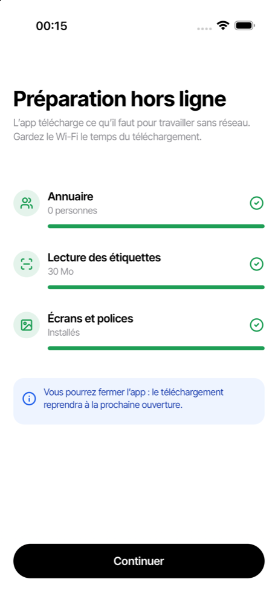

Si la connexion coupe en route, l'écran le signale : **Reprendre le téléchargement**
repart de là où il s'était arrêté. **Commencer en saisie manuelle** permet de travailler
tout de suite ; le téléchargement se termine à l'ouverture suivante.

L'app s'ouvre ensuite sur la liste **Colis**.

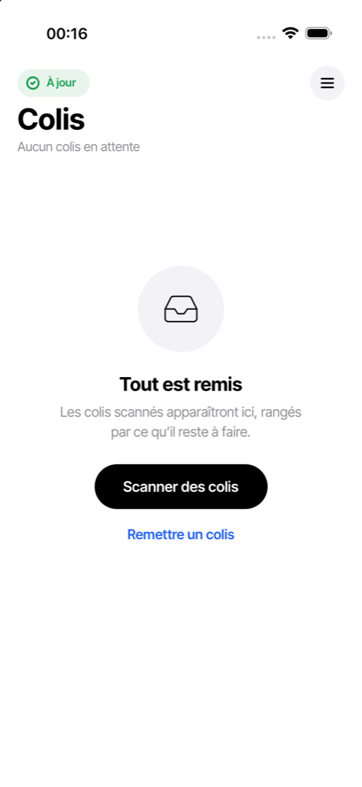

### 5. Autoriser la caméra

Touchez **Scanner** en bas de la liste (**Scanner des colis** quand la liste est vide).
L'app explique pourquoi elle a besoin de la caméra ;
touchez **Autoriser la caméra**.

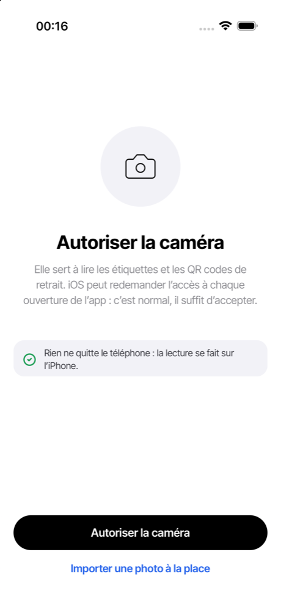

iOS demande alors l'accès : touchez **Autoriser**. iOS peut reposer la question à
d'autres ouvertures de l'app : c'est normal, il suffit d'accepter à nouveau.

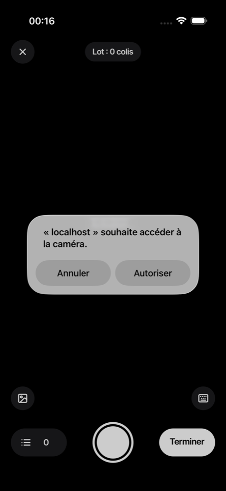

**Si l'accès a été refusé**, l'app affiche « La caméra est bloquée » avec la marche à
suivre :

1. ouvrez **Réglages** sur l'iPhone ;
2. touchez **Safari**, puis **Caméra** ;
3. choisissez **Autoriser** ;
4. revenez dans l'app et touchez **J'ai réautorisé, réessayer**.

En attendant, **Une photo** et **Au clavier** permettent d'enregistrer un colis sans la
caméra.

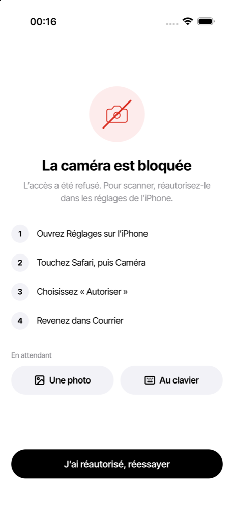

### 6. Tester un scan

Pour finir, visez l'étiquette d'un vrai colis : l'app bipe, affiche le numéro de suivi et
le destinataire, et le compteur du lot passe à 1. Touchez **Terminer**, vérifiez le colis
dans la revue du lot, puis touchez **Valider**. Le colis apparaît dans la liste **Colis** et la
pastille en haut à gauche indique **À jour** une fois envoyé au serveur.

## Réglages de l'iPhone recommandés

L'app ne chiffre pas elle-même ses données (choix validé pour cette version) : elle
s'appuie sur la protection d'iOS. Celle-ci ne protège vraiment les données que si
l'iPhone a un code. Sur chaque iPhone du service :

| Réglage                                        | Où                                                                      | Pourquoi                                                      |
| ---------------------------------------------- | ----------------------------------------------------------------------- | ------------------------------------------------------------- |
| **Code de verrouillage** à 6 chiffres au moins | Réglages › Face ID et code                                              | Sans code, iOS ne chiffre pas les données de l'iPhone.        |
| **Verrouillage automatique** à 1 ou 2 minutes  | Réglages › Luminosité et affichage › Verrouillage automatique           | Un iPhone posé à l'accueil se verrouille seul.                |
| **Face ID** activé                             | Réglages › Face ID et code                                              | Déverrouillage rapide malgré un code long.                    |
| **Mises à jour iOS** automatiques              | Réglages › Général › Mise à jour logicielle › Mises à jour automatiques | Les correctifs de sécurité d'iOS et de Safari arrivent seuls. |
| **Localiser mon iPhone** activé                | Réglages › [nom du compte Apple] › Localiser                            | Permet de localiser ou d'effacer un iPhone perdu.             |

Et quelques règles d'usage :

- l'iPhone du service reste au service : il ne se prête pas et ne sert pas à un usage
  personnel ;
- chaque agent se connecte avec son propre compte ;
- l'app n'envoie pas de notifications : il n'y a rien à autoriser de ce côté ;
- les photos d'étiquettes restent sur l'iPhone et ne partent jamais au serveur ; elles
  s'effacent seules 7 jours après la remise du colis.

## En cas de perte ou de vol

Ce qui est sur l'iPhone : la liste des colis, l'annuaire du service et les photos
d'étiquettes des colis récents. Avec un code de verrouillage, iOS garde ces données
chiffrées tant que l'iPhone est verrouillé.

À faire, dans cet ordre :

1. **Déconnecter l'iPhone** depuis un autre appareil, avec un compte administrateur :
   dans l'app, **Réglages › Appareils connectés**, touchez la ligne de l'iPhone perdu
   (nom de l'agent, « iPhone » et date de connexion), puis
   **Déconnecter cet appareil**. Si l'agent a plusieurs lignes « iPhone » et qu'on ne
   sait pas laquelle est la bonne, déconnectez-les toutes : il suffira de se reconnecter
   sur les iPhone encore en main.

   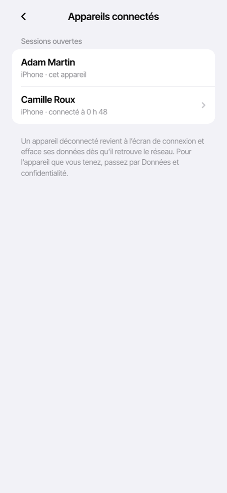

   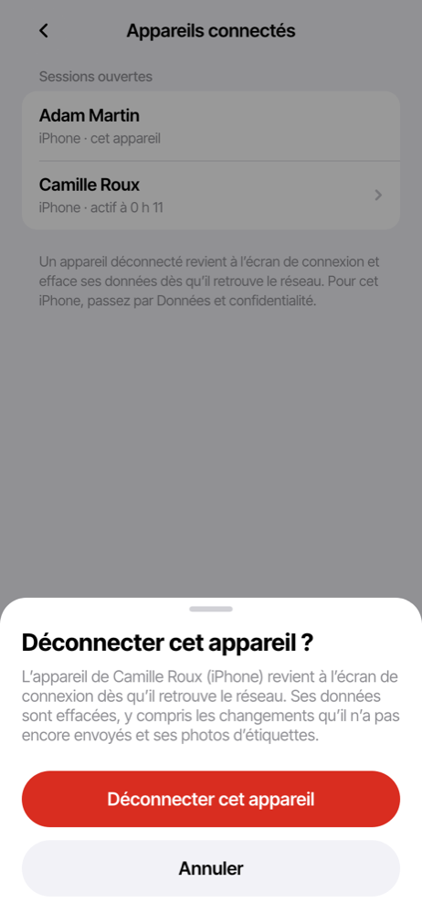

   La session de l'iPhone est fermée sur le serveur aussitôt : il ne peut plus rien
   envoyer ni recevoir. Dès qu'il retrouve le réseau, l'app efface toutes ses données
   (colis, annuaire, photos) et revient à l'écran de connexion. Les changements qu'il
   n'avait pas encore envoyés sont perdus ; tout ce qui avait été synchronisé reste sur
   le serveur.

2. **Effacer l'iPhone à distance** avec Localiser (icloud.com/find ou l'app Localiser
   d'un autre appareil Apple), si la DSI le gère ainsi.

3. **Prévenir la DSI** et l'équipe technique de l'app si le compte lui-même est en
   cause (mot de passe noté avec l'iPhone, par exemple) : l'administrateur de
   l'entreprise peut révoquer le compte ou changer son mot de passe depuis **Comptes**.

Tant qu'un iPhone déconnecté reste hors réseau (mode avion, sous-sol), l'app reste
utilisable sur place avec ce qu'elle avait déjà ; elle se vide à la première connexion.

## Changer d'iPhone ou réinstaller

- **Nouvel iPhone** : refaites l'installation complète sur le nouvel iPhone et
  connectez-vous avec le même compte. Les colis, l'annuaire et les modèles d'e-mail
  reviennent du serveur pendant la préparation hors ligne.
- **Les photos d'étiquettes ne suivent pas** : elles ne quittent jamais l'iPhone où elles
  ont été prises.
- **Avant de rendre ou de réattribuer l'ancien iPhone** : dans l'app,
  **Réglages**, touchez votre nom en haut, puis **Se déconnecter**. L'app envoie d'abord ce qui reste, puis efface
  ses données. Un administrateur peut aussi passer par
  **Réglages › Données et confidentialité › Effacer les données de cet iPhone**.
  Supprimez ensuite l'icône (appui long › Supprimer l'app web).
- **Réinstaller sur le même iPhone** (icône supprimée par erreur, affichage étrange) :
  refaites les étapes 2 à 4. iOS peut considérer la nouvelle icône comme une nouvelle
  app : reconnectez-vous si elle le demande, les données reviennent du serveur.

## Dépannage

| Situation                                                                        | Que faire                                                                                                                                                                                                      |
| -------------------------------------------------------------------------------- | -------------------------------------------------------------------------------------------------------------------------------------------------------------------------------------------------------------- |
| L'app est figée ou affiche un écran blanc                                        | Fermez-la (balayez vers le haut depuis le bas de l'écran et maintenez, puis balayez l'app vers le haut) et rouvrez-la depuis l'icône.                                                                          |
| « Nouvelle version disponible » sur la liste Colis                               | Touchez **Mettre à jour** quand vous avez un moment : l'app recharge en quelques secondes. Rien ne presse, la version en cours continue de fonctionner. Elle ne se met jamais à jour pendant un lot.           |
| Une mise à jour annoncée n'arrive pas                                            | **Réglages › Forcer la mise à jour**, en Wi-Fi.                                                                                                                                                                |
| La préparation hors ligne s'est arrêtée                                          | Repassez en Wi-Fi et touchez **Reprendre le téléchargement**, ou fermez et rouvrez l'app : elle reprend là où elle s'était arrêtée.                                                                            |
| La pastille reste orange (« changements en attente »)                            | L'iPhone n'a pas de réseau, ou le serveur a refusé un changement : **Réglages › Synchronisation** dit lequel. Les colis sont gardés sur l'iPhone en attendant.                                                 |
| L'app revient à l'écran de connexion sans raison                                 | La session a été fermée (iPhone déconnecté par un administrateur, compte désactivé, ou app pas ouverte depuis 30 jours) : l'app a effacé ses données. Reconnectez-vous ; tout ce qui avait été envoyé revient. |
| La caméra reste noire ou « bloquée »                                             | Voir l'étape 5 (Réglages › Safari › Caméra). Si elle reste noire, fermez et rouvrez l'app.                                                                                                                     |
| L'app s'ouvre avec la barre de Safari                                            | Elle a été ouverte depuis Safari, pas depuis l'icône. Ouvrez l'icône de l'écran d'accueil ; si elle manque, refaites l'étape 2.                                                                                |
| Safari annonce que les données d'un site sont effacées après 7 jours sans visite | Cela concerne les sites ouverts dans Safari, pas l'app installée sur l'écran d'accueil, qui garde ses données. C'est une raison de plus pour toujours passer par l'icône.                                      |
| Mot de passe oublié                                                              | L'administrateur de l'entreprise renvoie un lien depuis Comptes ; les photos et preuves restent sur l'iPhone. |

## Vérification

Liste à cocher sur un vrai iPhone après l'installation (les tests automatiques et le
simulateur ne remplacent pas ces gestes) :

- [ ] La page d'installation s'affiche dans Safari, avec les trois gestes ; depuis un
      ordinateur, le QR code ouvre bien l'adresse sur l'iPhone.
- [ ] **⋯ › Partager › En voir plus › Sur l'écran d'accueil** est bien le chemin sur
      iOS 26 (la place de Partager peut changer selon la barre de Safari choisie).
- [ ] L'icône ouvre l'app en plein écran, sans barre de Safari, directement sur la
      connexion.
- [ ] Connexion, préparation hors ligne complète en Wi-Fi, puis liste Colis.
- [ ] Autorisation de la caméra, refus puis réautorisation par Réglages › Safari ›
      Caméra.
- [ ] Un scan d'une vraie étiquette, un lot enregistré, pastille « À jour ».
- [ ] Relance en mode avion : l'app s'ouvre sur Colis et lit une étiquette sans réseau.
- [ ] Depuis un second appareil administrateur : **Réglages › Appareils connectés**
      liste l'iPhone ; **Déconnecter cet appareil**, puis rouvrir l'app sur l'iPhone en
      ligne : écran de connexion, liste vide après reconnexion d'un autre compte.
- [ ] En mode avion, un iPhone déconnecté reste utilisable ; il se vide au retour du
      réseau.
- [ ] Code de verrouillage, verrouillage automatique et Face ID réglés comme
      [recommandé](#réglages-de-liphone-recommandés).

> **Pour l'équipe technique** : les points de détail relevés pendant le développement
> (plein écran et barre d'état, hauteur de l'app installée, caméra, préparation hors
> ligne, mise à jour) sont suivis dans son fichier de suivi (`TODO.md`, tenu hors de ce
> dépôt) ; elle les vérifie en même temps que cette liste.
